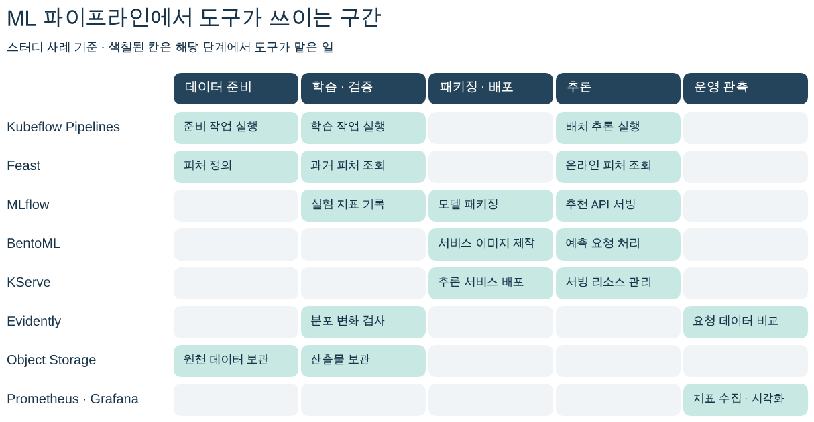

# ML 파이프라인 도구 비교

ML 시스템은 "데이터를 준비해 학습하고, 모델을 배포해 요청을 처리하고, 그 결과를 관측한다"는 흐름으로 굴러간다. 도구마다 이 흐름에서 맡는 구간과 답하는 질문이 다르다. 이 문서는 도구별 핵심 개념과 실무에서 쓰는 방식을 공식 문서 기준으로 정리하고, 이 저장소의 실습 코드와 확인한 사례를 연결한다.

## 한눈에 보기

| 도구 | 설명 | 비슷한 역할의 대안 | 스터디 |
|---|---|---|---|
| [Kubeflow Pipelines](#kubeflow-pipelines-kfp) | 데이터 준비·학습·추론 단계를 Kubernetes Pod로 순서대로 실행하고 입출력을 기록하는 워크플로 도구 | Airflow, Argo Workflows, Vertex AI Pipelines | 5~9장 |
| [Feast](#feast) | 피처 정의를 등록해 학습용 과거 값과 추론용 최신 값을 같은 정의로 조회하는 피처 스토어 | Tecton, Hopsworks, Databricks Feature Store | 4·5장 |
| [MLflow](#mlflow) | 학습 실행의 파라미터·지표를 기록하고 모델을 패키징·등록·서빙하는 실험 관리 도구 | Weights & Biases, Neptune | 4·9·10장 |
| [BentoML](#bentoml) | 전처리·모델·API 코드를 묶어 추론 서비스와 컨테이너 이미지로 만드는 서빙 프레임워크 | MLflow 서빙, FastAPI 직접 구현, Ray Serve | 6장 |
| [KServe](#kserve) | 추론 서버를 Kubernetes 리소스로 선언해 배포·교체·확장을 관리하는 서빙 플랫폼 | Seldon Core, 일반 Deployment | 6장 |
| [Evidently](#evidently) | 기준 데이터와 현재 데이터를 비교해 분포 변화와 품질 문제를 찾는 모니터링 라이브러리 | NannyML, WhyLabs | 6장 |
| [Object Storage (S3·MinIO)](#object-storage-s3--minio) | 데이터셋·모델·리포트 파일을 버킷과 키로 영구 보관하는 공통 저장소 | GCS, Azure Blob | 4·5·6장 |
| [Prometheus · Grafana](#prometheus--grafana) | 서비스 지표를 주기적으로 수집하고 대시보드·알림으로 보여주는 운영 모니터링 도구 | Datadog, CloudWatch | 11장 |

---

## Kubeflow Pipelines (KFP)

데이터 준비, 학습, 평가, 배치 추론 같은 단계를 컨테이너 작업으로 나누고, 의존 순서대로 Kubernetes Pod에서 실행한다. 각 단계의 입력·출력·로그·상태가 Run 단위로 남기 때문에 "그 모델은 어떤 데이터와 코드로 만들었나"를 추적할 수 있다.

### 핵심 개념

- **Component**: 컨테이너 하나에서 실행되는 함수. `@dsl.component`로 Python 함수를 감싸거나 컨테이너 이미지와 명령을 직접 지정한다.
- **Pipeline**: 컴포넌트를 연결한 DAG. 한 작업의 출력을 다음 작업의 입력으로 넘기면 실행 순서가 정해진다.
- **Run / Experiment / Recurring Run**: Run은 파이프라인을 한 번 실행한 기록이고, Experiment는 Run을 묶는 단위다. Recurring Run으로 일정에 따라 반복 실행한다.
- **Parameter와 Artifact**: Parameter는 숫자나 문자열 같은 작은 값이다. Artifact는 파일이나 디렉터리로, 타입(`Dataset`, `Model`, `Metrics`, `ClassificationMetrics`, `HTML`, `Markdown`)과 URI, 메타데이터를 함께 갖는다. Artifact는 KFP가 오브젝트 스토리지에 보관하고 다음 Pod에서 내려받는다.
- **실행 백엔드**: KFP v2는 파이프라인을 플랫폼 중립적인 IR YAML로 컴파일한다. 오픈소스 배포판에서는 Argo Workflows가 이 YAML을 받아 Pod를 실행한다.

### 실습 코드

| 하는 일 | 코드 |
|---|---|
| YAML로 정의한 컨테이너 컴포넌트를 불러와 파이프라인 구성 | [chapter-5/inference_pipeline.py](chapter-5/inference_pipeline.py) · [components/](chapter-5/components) |
| `Output[Dataset]` → `Input[Dataset]`로 Pod 사이에 파일 전달 | [chapter-7/movie_data_pipeline.py](chapter-7/movie_data_pipeline.py) |
| `Dataset → Model → Metrics` 학습·검증 파이프라인 | [chapter-8/pipeline.py](chapter-8/pipeline.py) |
| `dsl.If` / `dsl.Else` 조건 분기와 SDK 제출 | [chapter-6/pipeline/run_demo.py](chapter-6/pipeline/run_demo.py) |
| `kubernetes.mount_pvc`로 여러 단계가 같은 볼륨 공유 | [chapter-9/pipelines.py](chapter-9/pipelines.py) · [pvc_lifecycle.py](chapter-9/pvc_lifecycle.py) |

**실습에서 쓰지 않았지만 알아 두면 좋은 기능**

- `dsl.ParallelFor`: 같은 컴포넌트를 입력 목록만큼 병렬 실행한다. 하이퍼파라미터 탐색에 쓴다.
- `dsl.ExitHandler`: 앞 단계가 실패해도 마지막에 정리·알림 작업을 실행한다.
- `kubernetes.use_secret_as_env`: Kubernetes Secret을 컴포넌트 환경변수로 주입한다.
- Recurring Run: UI나 SDK에서 cron 일정으로 파이프라인을 반복 실행한다.

### 실무에서 쓰는 방식

- 학습·재학습 파이프라인을 Recurring Run이나 외부 트리거(데이터 도착, 드리프트 경고)로 실행한다.
- 컴포넌트마다 이미지를 고정 digest로 지정해 재현성을 확보한다. 같은 입력이면 캐시를 재사용해 비용을 줄인다.
- 평가 단계 결과를 조건으로 써서 기준을 넘은 모델만 레지스트리에 등록하는 게이트를 만든다.

### 주의할 점

- Pod 사이에는 파일 시스템이 공유되지 않는다. 다음 단계로 파일을 넘기려면 Artifact나 PVC를 써야 한다. 같은 PVC를 마운트해도 실행 순서는 자동으로 정해지지 않으므로 의존 관계를 명시해야 한다.
- 캐시는 컴포넌트 정의와 입력이 같으면 이전 결과를 재사용한다. 외부 데이터를 읽는 단계에서는 오래된 결과가 재사용될 수 있다.
- `Dataset` 타입을 붙여도 검사나 변환이 자동으로 되지는 않는다. 품질 검사는 컴포넌트 코드에 직접 구현해야 한다.

### 스터디에서 확인한 것

- [5장](chapter-5/README.md): `read-data → retrieve-features → run-inference → write-data` 4단계 배치 추론을 실행하고 100명의 예측 결과를 직접 추론과 대조했다.
- [6장](chapter-6/README.md): `dsl.If / dsl.Else`로 드리프트 게이트를 구현했다. 정상 데이터에서는 `infer`, 변형 데이터에서는 `skip` 작업만 실행됐다.
- [7장](chapter-7/README.md)·[8장](chapter-8/README.md): `Dataset → Model → Metrics` Artifact가 Pod 경계를 넘어 전달되는 것을 확인했다. [9장](chapter-9/RESULTS.md)에서는 PVC 공유 방식을 써 봤고, 내장 `CreatePVC`의 캐시 fingerprint 오류를 일반 컴포넌트로 우회했다.

---

## Feast

학습 때 쓴 피처와 추론 때 쓰는 피처가 서로 다른 코드와 저장소에서 나오면 학습·서빙 불일치(training-serving skew)가 생긴다. Feast는 피처 정의를 한곳에 등록하고, 학습용 과거 조회와 추론용 최신 조회를 같은 정의로 제공한다.

### 핵심 개념

- **Entity**: 피처를 조회하는 키. 예를 들면 `user_id`다.
- **Data Source**: 피처 원천. 파일(Parquet), BigQuery, Snowflake, Redshift, Spark 등을 쓴다. 이벤트 시각 컬럼(`timestamp_field`)이 필요하다.
- **FeatureView**: 엔티티, 원천, 스키마, TTL을 묶은 피처 그룹. TTL보다 오래된 값은 조회 결과에서 null로 처리된다.
- **FeatureService**: 모델 하나가 쓰는 피처 묶음. 모델 버전과 피처 구성을 함께 관리할 때 쓴다.
- **Offline Store / Online Store**: 오프라인 스토어는 학습용 과거 데이터를 조회하고, 온라인 스토어(Redis, DynamoDB, Bigtable, SQLite 등)는 엔티티별 최신값을 저지연으로 제공한다.
- **Registry**: 등록된 정의를 저장하는 파일이나 DB. S3 같은 공유 위치에 두면 여러 클라이언트가 같은 정의를 본다.

### Point-in-time join

`get_historical_features`는 엔티티 DataFrame의 각 행 시각을 기준으로, 그 시각 이전이면서 TTL 안에 있는 가장 최근 피처 값을 붙인다. 학습 라벨이 발생한 시점에는 알 수 없었던 미래 값이 학습 데이터에 섞이는 누수를 막아 준다.

### 실습 코드

| 하는 일 | 코드 |
|---|---|
| Entity·FileSource·FeatureView 정의 | [chapter-4/experiments/feature_store/feature_repo/features.py](chapter-4/experiments/feature_store/feature_repo/features.py) |
| `apply` → 과거 조회 → `materialize` → 온라인 조회 전체 흐름 | [chapter-4/experiments/feature_store/run_lab.py](chapter-4/experiments/feature_store/run_lab.py) |
| KFP 컴포넌트 안에서 과거 피처 조회 | [chapter-5/src/component.py](chapter-5/src/component.py) |
| 클러스터 Job으로 피처 정의 등록 | [chapter-5/src/register_features.py](chapter-5/src/register_features.py) |

**실습에서 쓰지 않았지만 알아 두면 좋은 기능**

- FeatureService: 모델 하나가 쓰는 피처를 묶어 이름으로 조회한다.
- On-demand FeatureView: 요청 시점 값과 저장된 피처를 조합해 즉석에서 변환한다.
- `feast serve`: 온라인 조회를 HTTP 피처 서버로 제공해 Python 이외의 서비스도 쓸 수 있게 한다.

### 실무에서 쓰는 방식

- 피처 엔지니어링은 Spark·dbt·SQL 파이프라인에서 하고, Feast는 결과 테이블을 등록·조회하는 계층으로 쓰는 경우가 많다.
- `materialize_incremental`을 KFP나 Airflow에서 주기적으로 실행해 온라인 스토어를 갱신한다.
- 피처 정의를 Git으로 관리하고 CI에서 `feast apply`를 실행해 변경 이력을 남긴다.

### 주의할 점

- `apply`는 정의만 등록한다. 온라인 스토어에 값이 들어가려면 `materialize`를 실행해야 한다.
- 온라인 조회 결과는 마지막으로 적재한 값이다. 적재 주기가 길면 오래된 값이 반환된다.
- 이벤트 시각에 시간대가 없으면 비교 과정에서 오류가 나거나 결과가 어긋날 수 있다. UTC로 명시해 두는 편이 안전하다.

### 스터디에서 확인한 것

- [4장](chapter-4/experiments/feature_store/README.md): MinIO의 Parquet를 원천으로 등록하고, 과거 조회 결과와 Redis 온라인 조회 결과가 원천과 일치하는지 확인했다. 원천 이전 시점을 조회하면 null이 나왔다. 시간대 없는 timestamp 때문에 Feast 0.40.1에서 비교 오류가 나서 UTC 사본을 만들어 해결했다.
- [5장](chapter-5/README.md): 배치 추론에서는 과거 시점 조회만 필요해 Redis 적재 없이 `retrieve-features` 단계에서 8개 피처를 조회했다.

---

## MLflow

실험이 늘어나면 어떤 코드·파라미터·데이터로 어떤 성능이 나왔는지 기억할 수 없다. MLflow는 학습 실행을 기록하고, 모델을 표준 형식으로 패키징하고, 레지스트리에서 버전을 관리하고, 같은 패키지를 HTTP로 서빙한다.

### 핵심 개념

- **Tracking**: Experiment 아래에 Run이 쌓이고, Run마다 파라미터, 지표(step별 시계열 가능), 태그, 아티팩트가 남는다. 저장소는 두 갈래다. 메타데이터는 backend store(SQLite, PostgreSQL 등)에, 파일은 artifact store(S3, MinIO 등)에 저장한다.
- **Model (MLmodel 형식)**: 모델 파일, 의존성(`conda.yaml`·`requirements.txt`), 입력 시그니처, flavor 정보를 한 디렉터리에 담는다. 어떤 flavor로 저장했든 `pyfunc` 인터페이스(`predict`)로 불러올 수 있다. MLflow 3에서는 모델이 Run과 별개인 Logged Model로 관리된다.
- **Model Registry**: 등록 모델의 버전을 관리한다. 예전의 Stage(Staging/Production)는 deprecated됐고, 지금은 alias(`@champion`)와 tag를 쓴다. `models:/income@champion` 같은 URI로 불러오면 alias가 가리키는 버전을 바꾸는 것만으로 배포 대상을 교체할 수 있다.
- **Custom PythonModel**: 전처리, 후처리, 여러 파일을 묶은 추론 로직을 `mlflow.pyfunc.PythonModel`로 감싸 하나의 모델처럼 패키징한다.

### 실습 코드

| 하는 일 | 코드 |
|---|---|
| SQLite backend store와 MinIO artifact store로 추적 서버 실행 | [chapter-4/experiments/start_mlflow_server.sh](chapter-4/experiments/start_mlflow_server.sh) |
| 후보 모델 비교, `log_model`로 전처리+모델 저장과 레지스트리 등록 | [chapter-4/experiments/income_experiment.py](chapter-4/experiments/income_experiment.py) |
| epoch별 지표(`step`)와 최종 test 지표 기록 | [chapter-9/recommend.py](chapter-9/recommend.py) · [chapter-8/train.py](chapter-8/train.py) |
| 추천 로직을 `PythonModel`로 패키징 | [chapter-10/package_model.py](chapter-10/package_model.py) |
| `mlflow models serve` 실행과 `/invocations` 호출 | [chapter-10/README.md](chapter-10/README.md#도전과제--mlflow로-영화-추천-호출하기) |

**실습에서 쓰지 않았지만 알아 두면 좋은 기능**

- Alias: `models:/<이름>@champion`처럼 별칭으로 모델을 불러온다. 별칭이 가리키는 버전만 바꾸면 배포 대상이 바뀐다.
- `mlflow.autolog()`: 주요 프레임워크의 파라미터와 지표를 자동으로 기록한다.
- `mlflow models build-docker`: 모델 패키지를 추론 서버 이미지로 만든다.

### 실무에서 쓰는 방식

- 하이퍼파라미터 탐색 결과를 Run으로 쌓고 UI에서 지표 기준으로 정렬·비교한다.
- 학습 파이프라인이 평가를 통과한 모델만 등록하고, 승인 절차를 거쳐 alias를 옮기는 방식으로 승격을 관리한다.
- 서빙 계층(BentoML, KServe, 자체 서버)이 레지스트리 URI로 모델을 가져가게 해서 학습과 배포를 분리한다.

### 주의할 점

- 지표만 기록하고 데이터 버전이나 코드 커밋을 남기지 않으면 재현할 수 없다. 데이터 경로·해시와 Git 커밋을 파라미터나 태그로 함께 남긴다.
- `mlflow models serve`는 단일 모델 서버다. 인증, 오토스케일링, 트래픽 분할은 제공하지 않으므로 운영에서는 KServe 같은 계층 위에 올린다.
- 서버 환경의 라이브러리 버전이 패키지와 다르면 서버 시작이나 추론에서 오류가 날 수 있다.

### 스터디에서 확인한 것

- [4장](chapter-4/Readme.md): MLflow 서버가 메타데이터는 SQLite에, 모델은 MinIO에 저장하는 구성으로 후보 모델을 비교하고 전처리와 분류기를 함께 저장했다.
- [9장](chapter-9/RESULTS.md): KFP 학습 Pod에서 지표를 기록하고 API로 `FINISHED` 상태를 확인했다. 영화 평점 test RMSE는 기준 모델 1.0090, 학습 모델 0.9433이었다.
- [10장](chapter-10/RESULTS.md): 추천 로직, 체크포인트, 평점 데이터를 `PythonModel`로 패키징해 `mlflow models serve`로 띄웠다. 사용자 50의 추천 세 편이 FastAPI 결과와 일치했다. MLflow 3.0.0 서버와 최신 FastAPI 사이의 호환 문제는 서버 프로세스에만 호환 버전을 적용해 해결했다.

---

## BentoML

노트북에서 동작하던 모델을 운영 API로 만들려면 입력 검증, 전처리, 의존성 고정, 컨테이너 빌드를 따로 해야 한다. BentoML은 이 과정을 Python 클래스 하나로 정의하고 Bento라는 배포 단위(코드, 모델, 의존성)로 묶어 이미지까지 만든다.

### 핵심 개념

- **Service**: `@bentoml.service`를 붙인 클래스. 리소스, 워커 수, 타임아웃 같은 실행 설정을 함께 선언한다.
- **API**: `@bentoml.api`를 붙인 메서드. 타입 힌트와 Pydantic으로 입력을 검증하고 HTTP 엔드포인트를 만든다.
- **Model Store**: 로컬 모델 저장소. `bentoml.sklearn.save_model`, `bentoml.mlflow.import_model` 등으로 저장하고 태그(`name:version`)로 참조한다.
- **Bento**: `bentofile.yaml`을 기준으로 `bentoml build`가 만드는 배포 단위. `bentoml containerize`로 OCI 이미지를 만든다.
- **Adaptive batching**: `@bentoml.api(batchable=True)`로 동시에 들어온 요청을 묶어 처리량을 높인다.

### 실습 코드

| 하는 일 | 코드 |
|---|---|
| MLflow 모델을 Bento Model Store로 가져오기 | [chapter-6/import_model.py](chapter-6/import_model.py) |
| `@bentoml.service`·`@bentoml.api`로 서비스와 입력 검증 정의 | [chapter-6/service.py](chapter-6/service.py) |
| Bento 빌드 설정(포함 파일, 고정한 의존성) | [chapter-6/bentofile.yaml](chapter-6/bentofile.yaml) |
| 예측 실패와 분리한 요청 로그 기록 | [chapter-6/request_log.py](chapter-6/request_log.py) |
| `build` → `containerize` 실행 순서 | [chapter-6/RUNBOOK.md](chapter-6/RUNBOOK.md#serving) |

**실습에서 쓰지 않았지만 알아 두면 좋은 기능**

- Adaptive batching: `@bentoml.api(batchable=True)`로 동시에 들어온 요청을 묶어 처리량을 높인다.
- `bentoml.depends()`: 서비스를 나눠 조합하고, 전처리와 모델을 따로 확장한다.

### 실무에서 쓰는 방식

- 전처리 → 모델 → 후처리를 한 서비스에 묶거나, `bentoml.depends()`로 서비스를 나눠 GPU 모델과 CPU 전처리를 따로 확장한다.
- 만든 이미지를 KServe, 일반 Kubernetes Deployment, BentoCloud 중 원하는 곳에 배포한다.
- 요청·응답을 구조화된 로그로 남겨 드리프트 분석의 입력으로 쓴다.

### 주의할 점

- 모델을 이미지에 포함하면 이미지가 커지는 대신 런타임 다운로드 의존성이 사라진다. 모델을 자주 바꾸면 외부 저장소에서 읽는 방식과 비교해 결정한다.
- `requirements` 버전을 고정하지 않으면 다시 빌드할 때 다른 라이브러리가 설치될 수 있다.
- 로깅이나 모니터링 코드의 실패가 예측 응답을 막지 않도록 분리해야 한다.

### 스터디에서 확인한 것

- [6장](chapter-6/README.md): MLflow의 인코더+RandomForest Pipeline을 Bento 모델로 가져와 이미지에 포함했다. 서빙 중에 MLflow에 접근하지 않고 예측했고, 필수 입력이 빠지면 HTTP 400을 반환했다. 모델 로딩 후 RSS가 약 33 MiB 늘었고, 로그 쓰기를 실패시켜도 예측은 성공했다.

---

## KServe

추론 서버를 Kubernetes에 직접 올리려면 Deployment, Service, 오토스케일러, 라우팅을 각각 작성해야 한다. KServe는 `InferenceService` 하나를 선언하면 컨트롤러가 이 리소스를 만들고 준비 상태를 보고한다.

### 핵심 개념

- **InferenceService (isvc)**: `predictor`(필수), `transformer`(전처리·후처리), `explainer`로 구성한다. predictor에는 `modelFormat`과 `storageUri`를 지정하거나 직접 만든 컨테이너를 지정한다.
- **ServingRuntime / ClusterServingRuntime**: sklearn, XGBoost, PyTorch(TorchServe), Triton, Hugging Face, vLLM 같은 모델 서버 템플릿. `modelFormat`에 맞는 런타임이 자동으로 선택된다.
- **Storage Initializer**: `storageUri`(S3, GCS, PVC 등)의 모델을 init container가 내려받아 서버에 전달한다.
- **배포 모드**: Serverless 모드는 Knative 기반으로 요청이 없으면 0개까지 줄이고 리비전별 트래픽 분할(`canaryTrafficPercent`)을 지원한다. RawDeployment 모드는 일반 Deployment·Service·HPA를 써서 구성이 단순하다. ModelMesh는 작은 모델 다수를 고밀도로 서빙할 때 쓴다.
- **추론 프로토콜**: V1(`/v1/models/<name>:predict`)과 Open Inference Protocol(V2, `/v2/models/<name>/infer`)을 지원한다.

### 실습 코드

| 하는 일 | 코드 |
|---|---|
| RawDeployment 모드로 직접 만든 BentoML 컨테이너를 predictor로 선언 | [chapter-6/cluster/gitops/income-service.yaml](chapter-6/cluster/gitops/income-service.yaml) |
| KServe 설치 | [chapter-6/cluster/install_kserve.py](chapter-6/cluster/install_kserve.py) |
| Argo CD Application(자동 동기화, `selfHeal`) | [chapter-6/cluster/gitops/application.yaml](chapter-6/cluster/gitops/application.yaml) |
| 소유 관계·`Ready`·API 응답 검사 | [chapter-6/cluster/gitops/verify_deployment.py](chapter-6/cluster/gitops/verify_deployment.py) |
| 이전 digest 커밋으로 롤백 후 복원 | [chapter-6/cluster/gitops/rollback_demo.py](chapter-6/cluster/gitops/rollback_demo.py) |

**실습에서 쓰지 않았지만 알아 두면 좋은 기능**

- `modelFormat` + `storageUri`: 직접 컨테이너를 만들지 않고 표준 런타임이 모델 파일을 내려받아 서빙하게 한다.
- `canaryTrafficPercent`: Serverless 모드에서 새 리비전에 트래픽 일부만 보낸다.
- `transformer`: 전처리·후처리를 predictor와 분리된 컨테이너로 둔다.

### 실무에서 쓰는 방식

- 모델별로 isvc를 Git에 두고 Argo CD로 동기화한다. 이미지 digest나 `storageUri`를 바꾸는 커밋이 곧 배포이고, 이전 커밋으로 되돌리는 것이 롤백이다.
- Serverless 모드에서는 새 리비전에 트래픽 일부만 보내 지표를 확인한 뒤 전체로 넘긴다.
- GPU 모델은 리소스 요청, 노드 셀렉터, 최소 레플리카를 지정해 콜드 스타트를 피한다.

### 주의할 점

- 카나리 트래픽 분할과 0개 축소는 Serverless 모드 기능이다. RawDeployment에서는 따로 구성해야 한다.
- 직접 만든 컨테이너를 쓰면 KServe 표준 프로토콜이 아니라 그 서버의 API를 그대로 쓴다.
- `Ready=True`는 컨테이너가 준비 검사를 통과했다는 뜻이다. 예측이 맞는지는 별도로 호출해 확인해야 한다.

### 스터디에서 확인한 것

- [6장](chapter-6/README.md): KServe 0.15.2 RawDeployment로 BentoML 이미지를 배포했다. 생성된 Deployment의 owner가 InferenceService인지, `Ready=True`인지, 실제 API가 응답하는지 확인했다. Argo CD로 이미지 digest를 바꾸는 커밋을 반영해 배포와 롤백·복원을 검증했다.

---

## Evidently

운영 중에는 정답 라벨이 늦게 들어오거나 아예 없을 수 있다. Evidently는 기준 데이터(reference)와 현재 데이터(current)를 비교해 분포 변화와 데이터 품질 문제를 먼저 찾는다.

### 핵심 개념

- **Dataset / DataDefinition**: pandas DataFrame에 컬럼 역할(수치형, 범주형, 텍스트, 타깃, 예측)을 붙인다. 역할에 따라 쓰는 통계 검정이 달라진다.
- **Report와 Preset**: Report는 지표 묶음을 계산한다. `DataDriftPreset`, `DataSummaryPreset`, `ClassificationPreset`, `RegressionPreset` 같은 Preset으로 자주 쓰는 지표를 한 번에 추가한다. 결과는 HTML, JSON, dict로 내보낸다.
- **Tests**: 지표에 통과·실패 조건을 붙이면 파이프라인의 게이트로 쓸 수 있다.
- **기본 드리프트 검정**: 표본이 1,000행 이하이면 수치형에 K-S 검정, 범주형에 카이제곱 검정(이진 범주는 Z-검정)을 쓰고 p-value 0.05를 기준으로 판단한다. 1,000행을 넘으면 수치형에 Wasserstein 거리, 범주형에 Jensen-Shannon 거리를 쓰고 임계값은 0.1이다. 드리프트로 판정된 컬럼 비율이 `drift_share`(기본 0.5) 이상이면 데이터셋 드리프트로 판정한다.

### 실습 코드

| 하는 일 | 코드 |
|---|---|
| `DataDefinition`·`DataDriftPreset`으로 리포트 생성 (`run(current, reference)` 순서) | [chapter-6/report_drift.py](chapter-6/report_drift.py) |
| 요청 로그를 윈도로 나눠 피처별 경고 생성 | [chapter-6/drift_alerts.py](chapter-6/drift_alerts.py) · [monitor_requests.py](chapter-6/monitor_requests.py) |
| 클러스터 로그 수집과 드리프트 검사 | [chapter-6/cluster/drift_demo.py](chapter-6/cluster/drift_demo.py) |
| KFP 게이트 단계에서 검사 결과를 `allow` 값으로 출력 | [chapter-6/pipeline/gate.py](chapter-6/pipeline/gate.py) |

**실습에서 쓰지 않았지만 알아 두면 좋은 기능**

- `ClassificationPreset` / `RegressionPreset`: 라벨이 들어온 뒤 성능 지표로 실제 하락 여부를 확인한다.
- Evidently UI: 리포트 결과를 프로젝트별로 쌓아 시계열 대시보드로 본다.

### 실무에서 쓰는 방식

- 요청 로그를 시간 또는 건수 단위 윈도로 모아 배치로 비교한다. 결과를 Evidently UI, Grafana, 알림 채널로 보낸다.
- 배치 추론이나 재학습 파이프라인 앞에 게이트로 두어, 입력 분포가 크게 바뀌면 실행을 멈추거나 사람이 검토하게 한다.
- 라벨이 들어오면 `ClassificationPreset`처럼 성능 지표로 실제 하락 여부를 다시 확인한다.

### 주의할 점

- 드리프트는 입력 분포가 바뀌었다는 신호다. 모델 성능이 떨어졌다는 증거는 아니다.
- 표본이 크면 p-value 기반 검정은 사소한 차이도 유의하게 판정한다. 그래서 큰 표본에서는 거리 기반 지표와 임계값을 쓴다.
- 기준 데이터를 무엇으로 잡느냐(학습 데이터, 지난주 운영 데이터)에 따라 결과의 의미가 달라진다.

### 스터디에서 확인한 것

- [6장](chapter-6/README.md): 요청 로그를 1,000건 윈도로 나눠 기준 데이터와 비교했다. 변형 데이터에서 `Education` JS 거리가 약 0.597로 경고가 났다. 같은 검사를 KFP `gate` 단계에 넣어, 정상 데이터(0.080)는 추론하고 변형 데이터는 건너뛰게 했다.

---

## Object Storage (S3 · MinIO)

Pod는 언제든 사라지므로 데이터와 모델은 Pod 밖에 있어야 한다. 오브젝트 스토리지는 대용량 파일을 버킷과 키로 영구 보관하고, HTTP API로 어디서든 읽게 한다. 대부분의 ML 도구가 S3 API를 공통 저장 계층으로 쓴다.

### 핵심 개념

- **Bucket / Object / Key**: 디렉터리 구조처럼 보이는 키(`datasets/2026-11/train.parquet`)는 실제로는 평평한 이름 공간이고, `/`는 prefix 구분자일 뿐이다.
- **객체 단위 쓰기**: 객체는 통째로 쓰고 통째로 교체한다. 일부만 수정할 수 없고, 디렉터리 이름을 바꾸면 내부적으로 모든 객체를 복사한다. 큰 파일은 multipart upload로 나눠 올린다.
- **일관성**: AWS S3는 쓰기 직후 읽기에 강한 일관성을 보장한다.
- **운영 기능**: 버전 관리(versioning), 수명 주기 규칙(오래된 객체 삭제·저가 계층 이동), presigned URL, 버킷 정책과 IAM 권한.
- **S3 호환 구현**: MinIO, Ceph, SeaweedFS 등이 같은 API를 제공한다. 자체 호스팅이나 로컬 실습에 쓴다.

### ML 도구가 쓰는 방식

| 사용처 | 저장하는 것 |
|---|---|
| 데이터 레이크 | 날짜별 파티션 Parquet, 원본 이미지·로그 |
| MLflow artifact store | 모델 디렉터리, 그래프, 평가 파일 |
| [Feast](#feast) | 오프라인 원천 Parquet, registry 파일 |
| KFP artifact root | 단계 사이에 전달되는 Dataset·Model·Metrics |
| KServe `storageUri` | 서빙할 모델 파일 |

### 주의할 점

- S3 호환 서버를 쓸 때는 도구마다 엔드포인트 설정 방법이 다르다(`AWS_ENDPOINT_URL`, `MLFLOW_S3_ENDPOINT_URL`, Feast `s3_endpoint_override` 등). MinIO는 path-style 주소가 필요한 경우가 많다.
- 같은 키에 덮어쓰면 이전 데이터가 사라진다. 실행 ID나 날짜를 키에 넣거나 버전 관리를 켠다.
- 파일을 보관하는 것과 그 파일이 어떤 실험이나 피처에 쓰였는지 추적하는 것은 별개다. 추적은 MLflow, Feast, KFP 같은 메타데이터 계층이 맡는다.

### 스터디에서 확인한 것

- [4장](chapter-4/experiments/feature_store/README.md): MinIO에 피처 원천 Parquet, Feast registry, MLflow 모델 artifact를 저장했다. 업로드한 파일의 SHA-256을 다시 내려받아 대조했다.
- [5장](chapter-5/README.md): KFP 내부 artifact는 클러스터의 SeaweedFS에, 최종 예측 결과는 4장 MinIO에 저장해 용도별로 저장소를 나눴다.

---

## Prometheus · Grafana

서비스가 떠 있는지, 요청을 얼마나 처리하는지, 어떤 결과가 늘고 있는지를 시계열로 관측한다. Evidently가 데이터 분포를 묻는다면, Prometheus는 서비스 동작을 묻는다.

### 핵심 개념

- **Pull 방식 수집**: Prometheus가 대상의 `/metrics` 엔드포인트를 주기적으로 읽는다(scrape). 수집에 성공하면 `up` 지표가 1이 된다.
- **지표 타입**: Counter(누적 증가), Gauge(현재 값), Histogram·Summary(지연 시간 분포).
- **Label**: 같은 지표를 차원별로 나눈다. 예: `recommendation_requests_total{outcome="ok"}`.
- **PromQL**: `rate(x[5m])`, `increase(x[1h])`, `histogram_quantile(0.95, ...)`로 비율·증가량·분위수를 계산한다.
- **Grafana**: Prometheus를 데이터 소스로 삼아 대시보드와 알림을 만든다.

### 실습 코드

| 하는 일 | 코드 |
|---|---|
| 추천 결과별 카운터와 `/metrics` 엔드포인트 | [chapter-10/serve.py](chapter-10/serve.py) |
| 수집 대상과 주기 설정 | [chapter-11/monitoring/prometheus.yml](chapter-11/monitoring/prometheus.yml) |
| Grafana 데이터 소스와 대시보드 | [chapter-11/monitoring/provisioning/](chapter-11/monitoring/provisioning) · [dashboards/movie.json](chapter-11/monitoring/dashboards/movie.json) |
| 요청 전후 카운터와 패널 시계열 대조 | [chapter-11/verify_monitoring.py](chapter-11/verify_monitoring.py) |

실습의 `/metrics`는 직접 작성한 텍스트 출력이다. 실무에서는 `prometheus_client` 같은 공식 클라이언트 라이브러리로 Counter·Histogram을 정의하는 경우가 많다.

### 실무에서 쓰는 방식

- 추론 API에 요청 수, 지연 시간 히스토그램, 결과별 카운터(성공, 미등록 사용자, 폴백)를 노출한다.
- 오류율이나 p95 지연이 임계값을 넘으면 Alertmanager나 Grafana 알림을 보낸다.
- Kubernetes에서는 Prometheus Operator의 ServiceMonitor·PodMonitor로 수집 대상을 선언한다.

### 주의할 점

- `user_id`처럼 값이 무한히 늘어나는 라벨을 붙이면 시계열이 폭증한다.
- Counter는 프로세스가 재시작되면 0으로 돌아간다. `rate`와 `increase`는 재시작을 보정하므로 원시 값보다 이 함수들로 본다.
- `up=1`은 수집이 된다는 뜻일 뿐이다. 사용자가 원하는 결과를 받았는지는 결과별 지표로 따로 봐야 한다.

### 스터디에서 확인한 것

- [11장](chapter-11/RESULTS.md): 추천 API의 `recommendation_requests_total`을 결과 라벨로 나눴다. 수집 대상이 UP인 동안에도 미등록 사용자 요청은 404와 `unknown_user` 증가로 따로 드러났다. Grafana 패널의 PromQL 시계열과 Prometheus 카운터 증가량이 일치했다.

---

## 역할이 갈리는 지점

같은 모델을 다뤄도 도구마다 확인하는 질문이 다르다. 비슷해 보이는 기능은 아래처럼 나눠서 본다.

| 헷갈리는 쌍 | 앞 도구가 답하는 것 | 뒤 도구가 답하는 것 |
|---|---|---|
| KFP ↔ MLflow | 학습 작업이 끝났나, 어떤 입출력으로 실행됐나 | 그 학습이 기준보다 좋았나, 어떤 모델 버전을 쓸까 |
| MLflow ↔ TensorBoard | 실행 사이 파라미터·지표 비교, 모델 등록 | 한 실행 안에서 step별 손실 곡선 |
| BentoML ↔ KServe | 요청을 받아 무엇을 계산하나(API, 전처리, 모델) | 그 서버를 클러스터에서 어떻게 띄우고 교체하나 |
| MLflow 서빙 ↔ BentoML | 등록된 모델을 표준 입력 형식으로 바로 서빙 | API 형태와 처리 로직을 직접 설계해 서빙 |
| Feast ↔ Object Storage | 시점과 키에 맞는 피처 값 | 원천 파일과 registry를 보관할 위치 |
| Evidently ↔ Prometheus | 입력 데이터 분포가 기준과 달라졌나 | 서비스가 요청을 어떻게 처리하고 있나 |

### 스터디 사례로 보면

- **학습 실행과 실험 비교.** 9장에서 영화 학습 작업이 끝났는지는 KFP의 작업 상태로 확인했다. 기준 모델보다 오차가 작은지는 MLflow에 기록한 test RMSE(1.0090 → 0.9433)로 판단했다. [9장 결과](chapter-9/RESULTS.md)
- **추론 코드와 배포.** 6장에서 BentoML은 인코더와 모델을 실행했고, KServe와 Argo CD는 그 이미지를 클러스터에 띄우고 교체했다. 10장에서는 MLflow 하나가 패키징과 로컬 HTTP 서빙을 모두 맡았다. [6장](chapter-6/README.md) · [10장](chapter-10/RESULTS.md)
- **서비스 상태와 데이터 품질.** 11장 Prometheus는 요청 결과별 카운터를 보여줬고, 6장 Evidently는 일정량의 입력을 모아 기준 분포와 비교했다. 요청이 정상 처리되는 중에도 입력 분포는 달라질 수 있다. [11장](chapter-11/RESULTS.md) · [6장](chapter-6/README.md)

6장의 소득 분류와 9~11장의 영화 추천은 별개의 실습이다. 영화 추천에서는 9장의 로컬 학습 산출물로 10장 서버를 띄웠고, 11장의 Prometheus는 그 FastAPI 서버를 관측했다.

## 도입 판단 기준

- **KFP**: 단계가 여러 개이고 Kubernetes에서 반복 실행해야 할 때 도입한다. 단일 스크립트 학습이면 cron이나 CI 작업으로 충분하다.
- **Feast**: 같은 피처를 학습과 온라인 추론에서 모두 쓰고, 시점 정합성이 중요할 때 가치가 크다. 배치 추론만 한다면 SQL 테이블 조인으로도 충분한 경우가 많다.
- **MLflow**: 실험을 두 번 이상 비교해야 하는 시점부터 쓴다. 도입 비용이 낮아 가장 먼저 들이는 도구인 경우가 많다.
- **BentoML vs MLflow 서빙**: 입력·출력 형식을 직접 설계하거나 여러 모델과 전처리를 조합한다면 BentoML이 맞다. 등록 모델을 빠르게 엔드포인트로 노출하는 것이 목적이면 MLflow 서빙으로 충분하다.
- **KServe**: 모델 수가 늘고 트래픽 분할, 오토스케일링, 표준 런타임이 필요할 때 도입한다. 모델 하나를 고정 레플리카로 운영한다면 일반 Deployment로도 충분하다.
- **Evidently**: 라벨이 늦게 들어와 성능을 바로 측정할 수 없는 서비스에서 먼저 쓴다.

## 공식 문서

- [Kubeflow Pipelines](https://www.kubeflow.org/docs/components/pipelines/) — [Artifacts](https://www.kubeflow.org/docs/components/pipelines/user-guides/data-handling/artifacts/), [Control flow](https://www.kubeflow.org/docs/components/pipelines/user-guides/core-functions/control-flow/)
- [Feast](https://docs.feast.dev/) — [Point-in-time joins](https://docs.feast.dev/getting-started/concepts/point-in-time-joins)
- [MLflow](https://mlflow.org/docs/latest/ml/) — [Tracking](https://mlflow.org/docs/latest/ml/tracking/), [Model Registry](https://mlflow.org/docs/latest/ml/model-registry/)
- [BentoML](https://docs.bentoml.com/en/latest/)
- [KServe](https://kserve.github.io/website/)
- [Evidently](https://docs.evidentlyai.com/)
- [Amazon S3](https://docs.aws.amazon.com/AmazonS3/latest/userguide/Welcome.html) · [MinIO](https://min.io/docs/minio/linux/index.html)
- [Prometheus](https://prometheus.io/docs/introduction/overview/) · [Grafana](https://grafana.com/docs/grafana/latest/)
