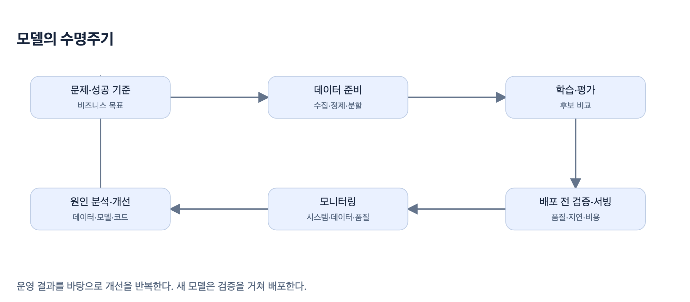
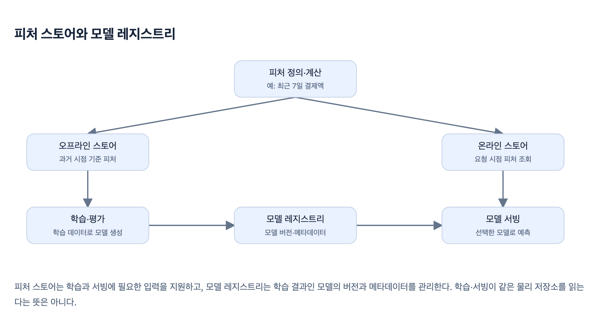
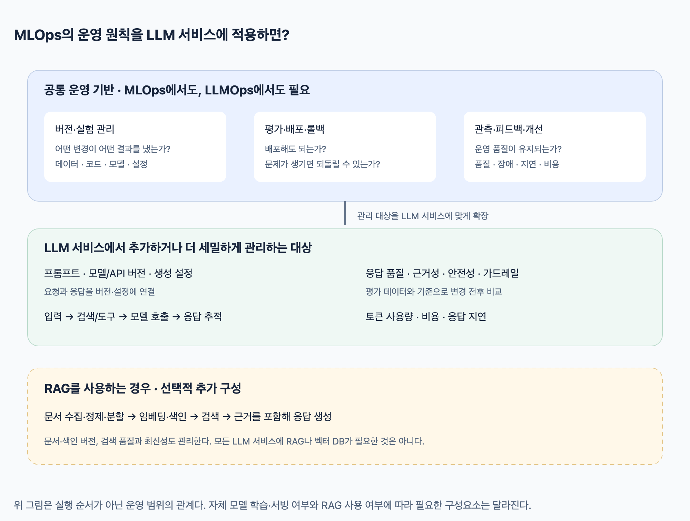

# CH1. MLOps와 ML 엔지니어링의 시작

> 출처: [1주차 핵심 정리 · MLOps 기초와 Kubernetes 배포](https://app.notion.com/p/1-MLOps-Kubernetes-40048126b0fe8140a110f062f42c4628) (Notion)
>
> 다이어그램 이미지는 Notion의 HTML 원본(`assets/*.html`)을 캡처한 것입니다.

## 1. 학습과 추론은 역할이 다르다

학습(training)은 데이터에서 패턴을 찾아 모델의 파라미터를 조정하는 과정이고, 추론(inference)은 학습된 모델을 실행해 새로운 입력의 결과를 얻는 과정이다.

| 용어 | 간단한 설명 |
| --- | --- |
| 피처(feature) | 모델 입력의 특성. 키·몸무게, 최근 7일 결제액 등. 원본 값일 수도 있고 가공한 값일 수도 있다. |
| 레이블(label) | 학습·평가에서 사용하는 정답. 스팸 여부나 이미지 속 물체의 위치 등. |
| 지도학습(supervised learning) | 입력과 그에 대응하는 정답(레이블)의 쌍으로, 입력에서 정답을 예측하는 관계를 학습하는 방식. 예: 이메일 본문과 스팸 여부로 학습하는 스팸 분류기. |
| 파라미터 / 가중치 | 학습 과정에서 조정되는 모델 내부 값. |
| 하이퍼파라미터 | 학습률·배치 크기처럼 학습 전에 정하거나 탐색하는 설정. |
| 텐서(tensor) | 숫자를 다차원 배열로 표현한 것. 이미지·텍스트도 수치화해 모델에 넣는다. |
| 역전파(backpropagation) | 손실이 각 파라미터에 얼마나 민감한지 기울기를 계산하는 방법. 옵티마이저가 이를 이용해 값을 갱신한다. |
| 과적합(overfitting) | 훈련 데이터에 지나치게 맞춰져 새로운 데이터에서 성능이 떨어지는 현상. |

**👉** 학습의 목표는 훈련 오차를 무조건 0으로 만드는 것이 아니라, 보지 못한 데이터에서도 잘 동작하게 하는 것이다.

## 2. 수명주기: 실험에서 운영으로

1. **문제 정의:** 예측 결과로 어떤 결정을 바꿀지, 성공 지표와 오판 비용을 정한다.
2. **데이터 준비:** 수집·정제·레이블링 후 훈련·검증·테스트 용으로 나눈다.
3. **학습·평가:** 모델 후보를 비교하고 데이터·코드·설정·결과를 기록한다.
4. **배포 전 검증:** 예측 품질뿐 아니라 지연·비용·보안·실제 사용 조건을 확인한다.
5. **배포·관찰·개선:** 운영 신호로 원인을 분석하고 다음 후보를 만든다.

| 데이터 분할 | 용도 |
| --- | --- |
| 훈련(train) | 모델 파라미터를 학습한다. |
| 검증(validation) | 모델·하이퍼파라미터를 선택한다. 선택에 반복 사용되므로 간접적으로 영향을 준다. |
| 테스트(test) | 선택을 마친 모델의 일반화 성능을 최종 확인한다. 반복적으로 맞춰 선택하면 독립 평가의 의미가 약해진다. |

**👉** 시계열은 미래 정보가 과거 예측에 섞이지 않도록 나누고, 동일 사용자·동일 문서에서 나온 유사 샘플이 양쪽에 섞이는지도 확인한다. 여기서 ‘검증 데이터’와 ‘배포 승인 검증’은 서로 다른 의미다.

## 3. ML 플랫폼의 핵심 부품

수명주기의 각 단계를 반복 가능하게 운영하도록 지원하는 도구들이다.

| 역할 | 해결하는 문제 | 스터디 도구 |
| --- | --- | --- |
| 파이프라인 오케스트레이션 | 전처리→학습→평가 등의 의존성과 실행·재시도를 관리 | Kubeflow Pipelines |
| 피처 스토어 | 피처 정의·재사용과 학습/서빙의 일관된 조회 지원 | Feast |
| 실험 추적 | Run별 설정·지표·모델 등 산출물 기록 | MLflow |
| 모델 레지스트리 | 모델 버전과 메타데이터를 관리하고 배포할 모델을 식별 | MLflow |
| 서빙 기반 | 모델을 API·배치 작업으로 실행하고 자원·확장·복구 관리 | 컨테이너·Kubernetes |

### 피처 스토어가 해결하려는 두 가지 문제

피처 스토어는 모델의 입력인 피처를 정의·관리하고, 학습과 서빙에서 재사용하도록 지원한다. 이때 중요한 것은 **과거 시점에 맞는 값을 가져오는 것**과 **학습·서빙에서 계산 기준을 맞추는 것**이다.

| 해결하려는 문제 | 관련 기능·개념 | 피처 스토어와의 연결 |
| --- | --- | --- |
| 과거를 학습하면서 미래 정보를 사용하는 문제 | Point-in-time correct 조회: 과거 예측 시점에 알 수 있었던 피처만 결합 | 과거 피처 이력과 시점 기준 조회를 이용해 미래 정보 누수를 방지한다. |
| 학습과 서빙에서 피처 계산·전처리 기준이 달라지는 문제 | Training-serving skew: 학습과 서빙 사이의 불일치 | 피처 정의·변환 로직을 공유하고 일관된 값 공급을 관리해 불일치를 줄인다. |

예를 들어 ‘최근 7일 결제액’이라는 피처를 쓴다고 하자.

- **시점 문제:** 3월 1일의 예측을 학습할 때는 그때 알 수 있었던 결제 내역으로 만든 값을 써야 한다. 3월 5일에 얻은 정보를 섞으면 미래 정보 누수다. 이를 다루는 기능이 Point-in-time 조회다.
- **일관성 문제:** 학습에서는 취소 결제를 제외했는데 서빙에서는 포함하면 같은 이름의 피처가 서로 다른 의미가 된다. 이런 학습–서빙 불일치를 Training-serving skew라고 한다. 계산 기준과 변환 로직을 공유해 줄여야 한다.

피처 스토어는 보통 **오프라인 스토어**의 과거 이력을 학습용 대량 조회에, **온라인 스토어**의 빠른 키 조회를 실시간 서빙에 활용한다. 저장소가 서로 달라도 피처의 정의와 계산 기준은 일치해야 한다.

👉 **Point-in-time은 올바른 과거 값을 조회하는 방식이고, Training-serving skew는 줄여야 할 문제의 이름이다.** 피처 스토어를 도입했다고 자동으로 해결되지는 않는다. 과거 이력·타임스탬프를 올바르게 기록하고, 데이터가 실제로 사용 가능해진 시점과 변환 로직·갱신 주기도 관리해야 한다.

## 4. MLOps의 확장: LLMOps

MLOps에서 익힌 **버전 관리·평가·배포·모니터링·개선**은 LLM 서비스에서도 필요하다. LLMOps는 이 운영 원칙을 LLM 서비스에 적용하면서, 프롬프트와 생성 응답 등 관리 대상을 확장한다.

예를 들어 모델은 그대로여도 프롬프트를 바꾸거나 검색 문서를 갱신하면 답변이 달라진다. 따라서 모델 버전만 관리하는 것으로는 변경의 영향과 원인을 파악하기 어렵다.

| 관리 대상 | 무엇을 관리하는가 | 필요한 이유 |
| --- | --- | --- |
| 프롬프트·모델·생성 설정 | 프롬프트 버전, 사용 모델/API 버전, temperature 등 | 답변에 영향을 준 변경을 추적하고 비교·롤백하기 위해 |
| 응답 평가·가드레일 | 평가용 질문·기준, 답변의 정확성·근거성, 유해 응답·민감정보 처리 | 정답이 하나로 고정되지 않는 생성 응답의 품질과 허용 범위를 관리하기 위해 |
| 호출 추적·토큰·비용·지연 | 검색·도구·모델 호출의 연결, 토큰 사용량, 비용과 응답 시간 | 실패·품질 저하의 원인을 찾고 서비스 비용·성능을 관리하기 위해 |
| RAG 데이터·검색 — 사용하는 경우 | 문서 수집·정제·분할, 임베딩·색인, 검색 품질·최신성 | 모델에 전달하는 근거가 바뀌어도 답변이 달라지므로, 문서·검색 경로도 관리하기 위해 |

- **임베딩:** 텍스트 등의 의미적 특성을 숫자 벡터로 표현하는 것. 유사한 내용 검색 등에 활용한다.
- **RAG:** 질문과 관련된 외부 자료를 검색하고, 그 자료를 모델의 입력에 포함해 답변을 생성하는 방식.
- **가드레일:** 입력·출력이 서비스에서 정한 허용 범위를 따르도록 검사·제한하는 장치. 오류나 유해 응답을 완전히 없애 주는 보장은 아니다.
