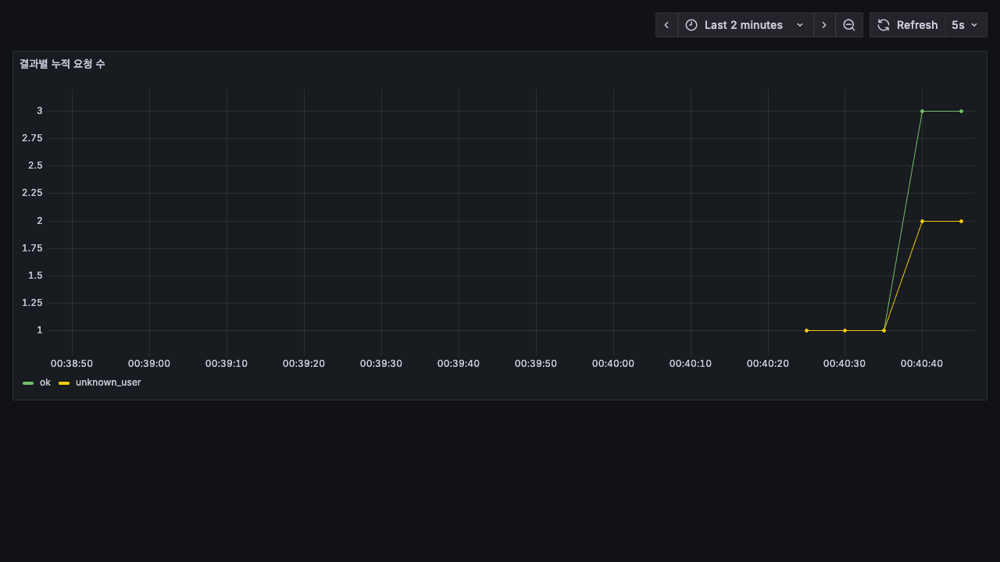

# Chapter 11 — 추천 요청 모니터링 실습 결과

| 요청 | HTTP 응답 | recommendation_requests_total 변화 |
|---|---|---|
| 사용자 50 | 200, 영화 세 편 | ok 0 → 1 |
| 사용자 999999 | 404, unknown_user | unknown_user 0 → 1 |

두 요청 모두 서버가 응답했지만 추천을 받은 요청은 한 건이었다. 서비스 가용성과 개인화 추천을 제공한 비율을 따로 볼 이유다. 이번 두 건은 동작 확인용이며 운영 트래픽의 성공률 추정에는 쓸 수 없다. [호출 전후 지표와 응답 기록](results/probe.json)

9장 테스트에서는 640개 사용자·영화 쌍 가운데 186개에 학습에 없던 사용자 또는 영화가 포함됐다. 이 오프라인 수치는 평점 쌍 단위다. 이번 온라인 지표는 사용자 요청 단위이며, 정답 평점 없이도 집계할 수 있다. 카운터는 서버 재시작 시 초기화된다. 이번에는 HTTP로 지표 노출까지 확인했다.

## Prometheus와 Grafana에서 확인한 요청 변화

Prometheus의 수집 대상 movie-recommendations가 UP인 상태에서 요청을 보냈다. 기존 API에 누적된 값은 두 결과 모두 1이었다. 다음 수집에서 사용자 50의 추천 두 건(HTTP 200)은 ok를 1에서 3으로, 미등록 사용자 한 건(HTTP 404)은 unknown_user를 1에서 2로 올렸다. Grafana 패널의 PromQL 쿼리와 브라우저 화면에서 같은 변화를 확인했다.

UP은 Prometheus가 API의 지표를 읽을 수 있다는 뜻이다. 미등록 사용자에게 추천을 제공하지 못한 시점에도 수집은 정상이라서, 추천 결과는 별도의 카운터로 살펴야 한다. [요청과 패널 시계열 원본](results/prometheus-grafana.json)
