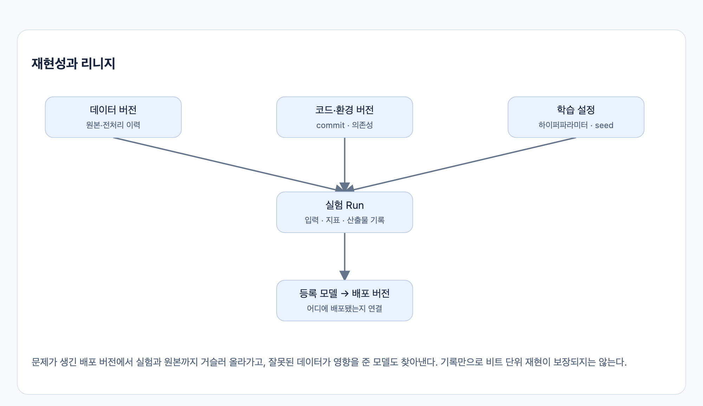
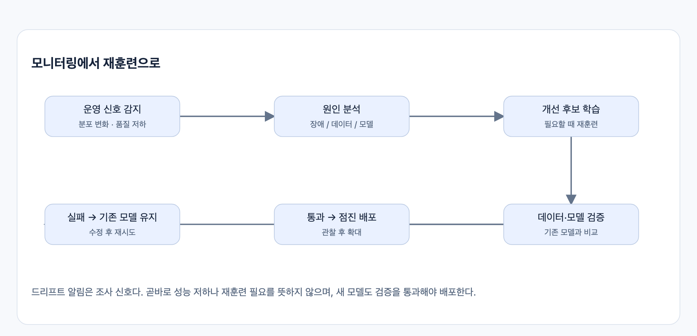

# CH2. MLOps란 무엇인가

> 출처: [1주차 핵심 정리 · MLOps 기초와 Kubernetes 배포](https://app.notion.com/p/1-MLOps-Kubernetes-40048126b0fe8140a110f062f42c4628) (Notion)
>
> 다이어그램 이미지는 Notion의 HTML 원본(`assets/*.html`)을 캡처한 것입니다.

## 1. MLOps의 역할: 재현 가능하고 안정적인 ML 운영

MLOps는 ML 시스템의 개발·배포·운영·개선을 연결하는 실천 방법과 운영 체계다. 데이터·코드·모델·설정의 관계를 추적하고, 반복 작업을 자동화하며, 품질을 검증한 변경을 안정적으로 배포하도록 돕는다.

- **재현성·추적 가능성:** 어떤 데이터·코드·설정으로 모델이 만들어졌고 어디에 배포됐는지 파악한다.
- **자동화·일관성:** 데이터 처리·학습·검증·배포를 반복 가능한 절차로 만든다.
- **운영 신뢰성:** 품질·장애·지연·비용을 관찰하고, 문제가 생기면 원인을 찾아 수정하거나 롤백한다.

## 2. 모델보다 먼저 데이터 신뢰성을 확보한다

- **큐레이션(curation):** 목적에 맞게 데이터를 선별·정제하고 품질·출처를 관리한다.
- **EDA:** 분포·결측·이상치·클래스 비율·변수 관계를 탐색해 가정을 확인한다.
- **편향(bias):** 수집·레이블링 등이 특정 집단이나 상황에 치우쳐 결과를 왜곡할 수 있다.
- **데이터 누수(leakage):** 예측 시점에 없던 정보나 평가 데이터가 학습·모델 선택에 섞여 성능이 부풀려진다.

밝은 실내 이미지로만 학습해 야간 사진에 실패하는 것은 대표성 문제다. 사기 확정 후 생성되는 계정 정지 여부로 사기를 예측하면 미래 정보 누수다. 전처리 통계도 훈련 데이터에서 계산하고 검증·테스트에는 그 변환을 적용한다.

## 3. 모델 평가 지표: 무엇을 잘한다고 볼 것인가

준비한 데이터로 모델을 학습한 뒤에는, 학습에 사용하지 않은 데이터로 예측 품질을 평가한다. 평가 지표와 통과 기준은 학습 전에 정하고, 그 기준으로 모델 후보를 비교한다. MLOps는 학습·평가를 반복 실행하고 결과를 추적할 수 있도록 지원한다.

| 지표 | 간단한 뜻 |
| --- | --- |
| 정밀도(precision) | 양성이라고 예측한 것 중 실제 양성의 비율. ‘잡은 것 중 얼마나 맞았나?’ |
| 재현율(recall) | 실제 양성 중 모델이 찾아낸 비율. ‘놓치지 않고 얼마나 잡았나?’ |
| F1 | 정밀도와 재현율의 조화평균. 둘의 균형을 보지만 실제 오판 비용을 모두 표현하지는 않는다. |
| MAE | 예측과 정답의 절대 차이의 평균. 원래 단위로 해석하기 쉽다. |
| MSE | 예측 오차를 제곱해 평균. 큰 오차에 더 큰 벌점을 준다. |

예를 들어 사기 탐지에서는 재현율을 높이는 과정에서 정상 거래까지 사기로 분류하는 오탐이 늘 수 있다. 놓친 사기의 손실과 정상 거래를 차단하는 영향을 고려해 평가 기준을 정한다. 하나의 지표만 높다고 배포할 모델로 적합한 것은 아니다.

## 4. 버전 관리·실험 추적·리니지는 한 세트다

**버전 관리**는 무엇이 바뀌었는지, **실험 추적**은 어떤 설정으로 어떤 결과를 얻었는지, 리니지(lineage)는 원본 데이터에서 모델과 배포까지 무엇이 연결되는지를 알려 준다.

최소한 데이터 버전·전처리 코드·학습 코드 commit·의존성·설정·지표·산출물·배포 버전을 연결해 기록한다. 운영 장애 시 원인을 거슬러 찾고, 잘못된 데이터가 영향을 준 모델을 조사할 수 있어야 한다.

**👉** 리니지는 분기·병합을 포함하는 관계이며 반드시 선형일 필요가 없다. 이력 기록이 재생성 비용을 줄이지만 ‘쿼리 한 번으로 복구’나 완벽한 재현을 자동 보장하지는 않는다. 난수·하드웨어·연산의 비결정성도 고려한다.

## 5. 모니터링은 세 층으로 본다

| 관찰 대상 | 예시 | 알 수 있는 것 |
| --- | --- | --- |
| 시스템 | 에러율·RPS·p95/p99 지연·CPU/GPU·메모리 | 서비스가 정상 실행되는가 |
| 데이터·모델 | 입력 분포·결측·예측 분포·레이블 확보 후 품질 | 입력과 예측이 기대대로 유지되는가 |
| 비즈니스 | 전환율·이탈률·사기 손실·처리 비용 | 서비스가 실제 목표에 기여하는가 |

**데이터 드리프트**는 입력 데이터의 분포 변화이고, **컨셉 드리프트**는 입력과 정답의 관계가 달라지는 것이다. 드리프트가 감지됐다고 반드시 품질이 낮아진 것은 아니며, 레이블이 늦게 도착하면 즉시 정확도를 계산하기 어렵다.

재훈련은 일정·새 데이터·운영 신호로 시작할 수 있다. 다만 원인 분석과 새 모델 검증을 거쳐야 하며, 재훈련 자체가 개선을 보장하지 않는다. 코드가 그대로여도 외부 데이터가 바뀌어 기존 모델의 성능이 떨어질 수 있다.

## 6. DevOps와 MLOps, 성숙도

MLOps는 DevOps의 자동화·테스트·배포·관측 원칙을 활용하면서 **데이터·모델·실험**을 관리 대상으로 확장한다.

| 구분 | 핵심 |
| --- | --- |
| CI: 지속적 통합 | 변경을 테스트하고 빌드·데이터/모델 관련 검사를 수행 |
| CD: 지속적 전달·배포 | 검증된 서비스·모델·파이프라인을 배포 가능한 상태로 만들거나 배포 |
| CT: 지속적 훈련 | 새 데이터·일정·신호에 따라 학습 파이프라인 반복 실행 |

스터디의 성숙도 구분은 **Level 0: 수동 중심 → Level 1: 학습 파이프라인 자동화 → Level 2: 파이프라인 자체의 CI/CD 자동화**다. 조직의 등급표보다 ‘어떤 반복 작업과 검증이 자동화됐는가’를 보는 기준으로 활용한다.
