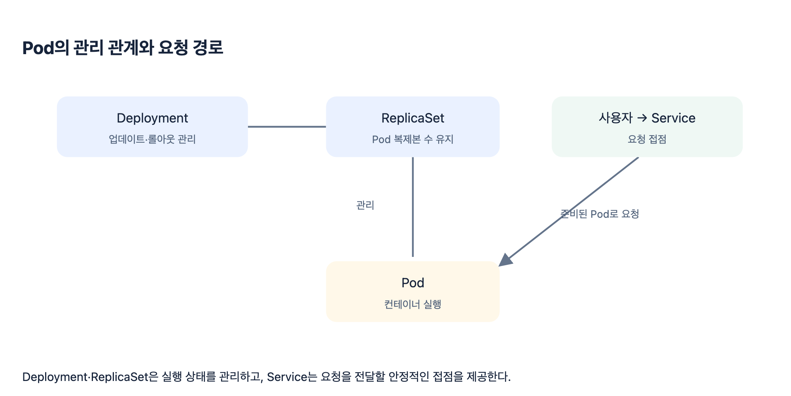
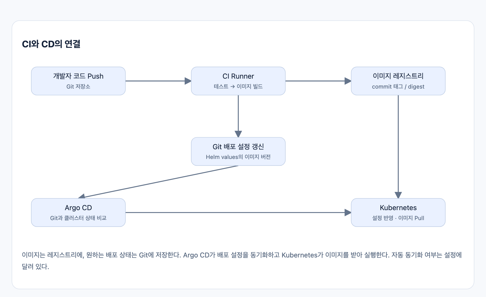
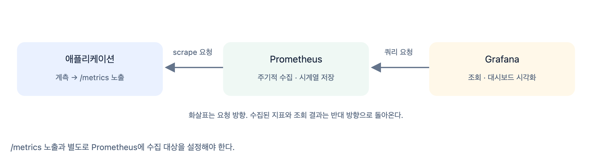

# CH3. 컨테이너·배포·모니터링 핵심 개념

> 출처: [1주차 핵심 정리 · MLOps 기초와 Kubernetes 배포](https://app.notion.com/p/1-MLOps-Kubernetes-40048126b0fe8140a110f062f42c4628) (Notion)
>
> 다이어그램 이미지는 Notion의 HTML 원본(`assets/*.html`)을 캡처한 것입니다.

ML 서비스를 실행하는 기반도 일반 애플리케이션과 같은 컨테이너·배포·관측 도구를 활용한다.

## 1. Docker: 실행 환경 패키징

앱과 의존성을 **이미지**로 빌드해 레지스트리에 저장하고, 그 이미지를 **컨테이너**로 실행한다.

## 2. Kubernetes: 원하는 실행 상태 유지

| 구성요소 | 역할 |
| --- | --- |
| Pod | 컨테이너를 실행하는 기본 단위 |
| Deployment / ReplicaSet | Pod 복제본 유지와 업데이트 관리 |
| Service | Pod에 접근하는 안정적인 이름·접점 제공 |
| Helm | Kubernetes 배포 명세를 패키징하고 환경별 설정 관리 |

**Deployment → ReplicaSet → Pod**는 관리 관계이고, **Service → Pod**는 요청 전달 관계다.

## 3. CI/CD와 GitOps: 변경을 배포로 연결

- **CI:** 코드 테스트와 이미지 빌드·Push를 자동화한다.
- **GitOps:** Git의 선언적 배포 설정을 원하는 운영 상태의 기준으로 삼는다.
- **Argo CD:** Git과 클러스터 상태의 차이를 확인하고, 수동·자동 동기화로 반영한다.

## 4. 모니터링: 지표 노출·수집·시각화

요청 수·에러율·응답 시간 등을 관찰해 서비스의 이상을 확인한다.

| 역할 | 구성요소 |
| --- | --- |
| 지표 노출 | 계측 라이브러리·Exporter가 지표를 제공한다. 앱 내부 지표는 /metrics 같은 엔드포인트로 노출한다. |
| 수집·저장 | Prometheus가 설정된 대상을 주기적으로 scrape하고 시계열로 저장한다. |
| 조회·시각화 | Grafana가 Prometheus를 조회해 대시보드로 보여준다. |

- **Counter:** 요청 수처럼 누적되는 횟수를 측정한다.
- **Histogram:** 응답 시간처럼 관측값의 분포를 측정한다.
