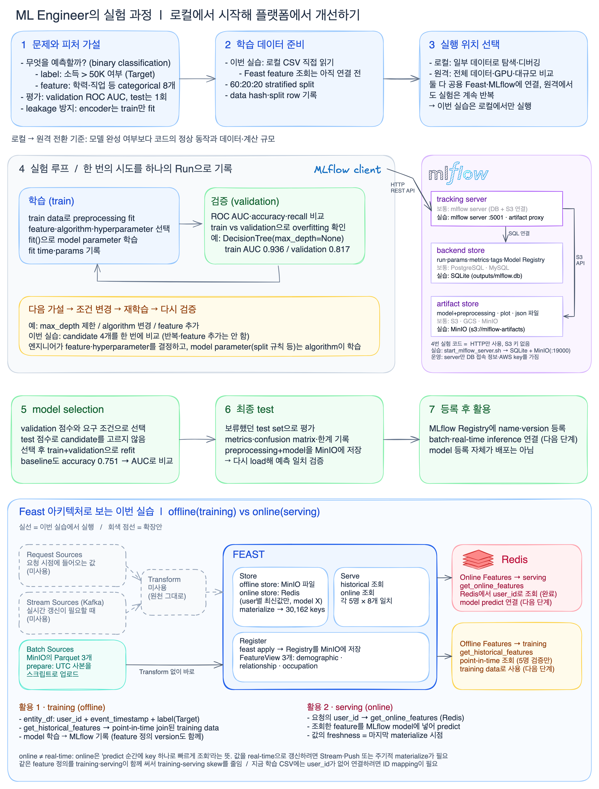
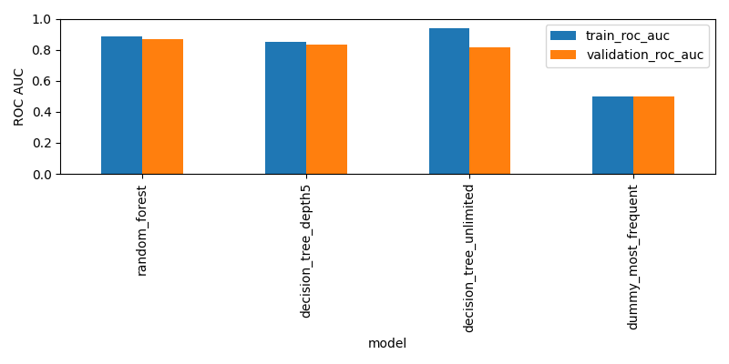

# Chapter 4 — MLflow 실험 관리와 Feast 피처 스토어

소득 분류 모델을 비교하고 MLflow에 실험·모델을 기록한 뒤, Feast로 과거 피처와 온라인 피처를 조회하는 로컬 실습이다. Python은 Mac에서 실행하고, MinIO와 Redis는 Docker Compose로 띄운다.

## 실습에서 확인하는 것

- **MLflow:** 어떤 데이터·설정으로 학습했는지 기록하고, 후보 모델을 비교해 전처리와 모델을 함께 저장한다.
- **Feast:** 피처 정의를 등록하고, 시점에 맞는 과거 조회와 사용자 ID 기반 온라인 조회의 차이를 확인한다.
- **Chapter 5 연결:** 저장한 모델과 피처를 [KFP 배치 추론 파이프라인](../chapter-5/README.md)에서 재사용한다.

학습 코드가 읽는 데이터는 로컬 CSV다. 이 챕터에서는 모델 학습과 Feast 조회를 각각 검증하며, Feast 피처를 모델 추론에 연결하는 작업은 Chapter 5에서 진행한다.

## 구성



| 구성 요소 | 역할 | 실습 위치·주소 |
|---|---|---|
| 학습 코드 | 후보 비교, 평가, MLflow 기록 | `experiments/income_experiment.py` |
| MLflow 3.0.0 | 실험 추적, Model Registry, artifact 업로드 중계 | http://127.0.0.1:5001 |
| SQLite | MLflow 실행 기록·지표·모델 등록 정보 | `experiments/outputs/mlflow.db` |
| MinIO | 모델 artifact, 원천 Parquet, Feast Registry 저장 | API `127.0.0.1:19000` · [Console](http://127.0.0.1:19001) |
| Feast 0.40.1 | 피처 등록, 과거 조회, Redis 적재·온라인 조회 | 로컬 Python 환경 |
| Redis | 사용자별 최신 피처 값 저장 | `127.0.0.1:16379` |

학습 코드는 MLflow 서버에 HTTP로 기록을 보낸다. 서버가 메타데이터를 SQLite에, 모델과 그래프를 MinIO에 저장한다. Feast는 MinIO의 원천 데이터를 조회하고, `materialize`로 Redis에 값을 적재한다. 구성도의 상세 설명은 [실험 아키텍처](experiments/README.md#architecture)를 참고한다.

## 시작하기

아래 명령은 **`chapter-4` 폴더에서** 실행한다. Docker Desktop과 Python 3.10.17이 필요하다. Compose 이미지는 실습한 Mac의 ARM64 digest로 고정되어 있다.

### 1. Python 환경 준비

기존 `venv`가 있으면 재사용한다. 처음 설치할 때는 다음을 실행한다.

```bash
python3.10 -m venv venv
venv/bin/pip install -r requirements.txt
```

노트북을 사용하려면 커널도 등록하고 VS Code/Jupyter에서 **Python (chapter-4 venv)**를 선택한다.

```bash
venv/bin/pip install ipykernel
venv/bin/python -m ipykernel install --user --name chapter4-venv --display-name "Python (chapter-4 venv)"
```

### 2. 로컬 서비스 시작

```bash
docker compose -f experiments/feature_store/compose.yaml up -d --wait
bash experiments/start_mlflow_server.sh
```

MLflow 서버를 실행한 터미널은 유지한다. 이미 서비스가 실행 중이면 다시 띄우지 않는다. MinIO 로그인과 서비스별 설정은 [피처 스토어 구성](experiments/feature_store/README.md#구성)에 정리되어 있다.

### 3. 모델 비교와 저장

다른 터미널에서 다음을 실행한다.

```bash
venv/bin/python experiments/income_experiment.py
```

[MLflow UI](http://127.0.0.1:5001)의 `assignment-income-classification` 실험에서 후보별 지표를 비교한다. `phase=candidate`는 후보 비교, `phase=final`은 최종 테스트다. Models에는 `assignment-income-classifier`가 등록된다.

노트북으로 따라가려면 [income_experiment.ipynb](experiments/income_experiment.ipynb)를 연다. 데이터 분할·모델 선택 조건과 출력 파일 설명은 [모델 실험 안내](experiments/README.md)에 있다.

### 4. Feast 피처 등록과 조회

```bash
venv/bin/python experiments/feature_store/run_lab.py prepare
venv/bin/python experiments/feature_store/run_lab.py apply
venv/bin/python experiments/feature_store/run_lab.py historical
venv/bin/python experiments/feature_store/run_lab.py materialize
venv/bin/python experiments/feature_store/run_lab.py online
```

`prepare`는 원천 데이터를 업로드하고, `apply`는 피처 정의를 등록한다. `historical`은 과거 시점의 값을 조회한다. 온라인 조회를 하려면 먼저 `materialize`로 Redis에 실제 값을 적재해야 한다.

사용자 5명의 8개 피처가 원천과 일치하는지, 원천 이전 시점의 조회는 null을 반환하는지 검증한다. 단계별 설명은 [Feast 실습 안내](experiments/feature_store/README.md), 실행 노트북은 [feature_store_lab.ipynb](experiments/feature_store/feature_store_lab.ipynb)를 참고한다.

## 실습 결과

저장된 모델 실험은 30,162행을 학습 18,096행·검증 6,033행·테스트 6,033행으로 나눴다. 검증 ROC AUC로 RandomForest를 선택한 뒤 학습·검증 데이터를 합쳐 재학습하고, 별도의 테스트 데이터로 평가했다.

| 항목 | 결과 |
|---|---|
| 선택 모델 | RandomForest |
| 테스트 ROC AUC | 0.8773 |
| 테스트 정확도 | 0.8248 |
| 테스트 정밀도 / 재현율 | 0.7296 / 0.4707 |
| 테스트 F1 | 0.5722 |
| 저장 모델 재로딩 | 예측 일치 확인 |



수치는 [result.json](experiments/results/result.json), 후보별 비교는 [comparison.csv](experiments/results/comparison.csv), 오분류 분포는 [혼동행렬](experiments/results/test_confusion_matrix.png)에서 확인할 수 있다. 무작위 분할 한 번의 실습 결과이며 실제 서비스 성능을 보장하는 수치는 아니다.

새 실행 결과와 DB는 Git에서 제외된 `experiments/outputs/`에 생성된다. 문서에 포함한 결과는 `experiments/results/`에 보관한다. 재학습하면 새 모델 URI가 생기므로, Chapter 5에서 사용할 모델 URI도 함께 확인해야 한다.

## Chapter 5로 이어가기

[Chapter 5](../chapter-5/README.md)는 여기서 저장한 모델과 MinIO의 피처를 사용해 `입력 읽기 → 피처 조회 → 모델 추론 → 결과 저장`을 KFP에서 실행한다. 배치 추론은 Feast의 과거 조회를 사용하므로 Redis 온라인 적재 결과에는 의존하지 않는다.

교재 원본의 `mlflow/`, `feast/`, `feast_retrieval/`, `scripts/`도 저장소에 남아 있다. 이 저장소의 로컬 실행은 위 `experiments/` 경로를 기준으로 한다. 원본의 포트·접속 정보와 로컬 실습 설정을 섞지 않는다.

실습을 마치면 MLflow 터미널에서 `Ctrl+C`, MinIO·Redis는 아래 명령으로 중지한다. Chapter 5를 이어서 실행한다면 필요한 MLflow·MinIO 서비스를 유지한다.

```bash
docker compose -f experiments/feature_store/compose.yaml stop
```
