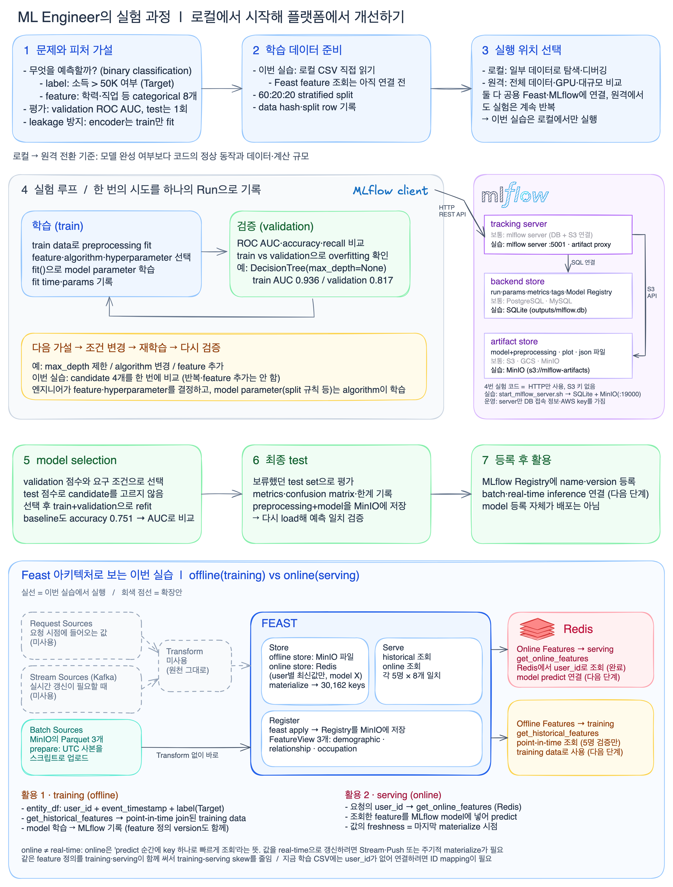

# 소득 분류 실험

질문: 다수 클래스만 예측하는 기준 모델보다 학습한 모델이 얼마나 좋아질까?
추가 관찰: 의사결정나무의 깊이를 제한하면 학습과 검증 성능의 차이가 줄어들까?

## Architecture



원본은 [`diagrams/ch4-experiment-workflow.excalidraw`](diagrams/ch4-experiment-workflow.excalidraw)이다.
위쪽 1~7은 실험 workflow, 오른쪽 MLflow 영역과 아래 Feast 영역은 이 실습에서 띄운 구성 요소다.
그림에서 실선은 이번 실습에서 실행한 경로, 회색 점선은 아직 연결하지 않은 확장 경로다.

### 구성 요소

| 구성 요소 | 역할 | 이 실습의 구현 | 주소 |
|---|---|---|---|
| 실험 코드 (MLflow client) | 학습·평가 후 `log_params`·`log_metrics`·`log_model` 호출 | `experiments/income_experiment.py` | — |
| MLflow tracking server | client 요청을 받아 DB에 기록하고 artifact를 대신 업로드(artifact proxy), UI 제공 | `experiments/start_mlflow_server.sh` (venv의 `mlflow server`) | http://127.0.0.1:5001 |
| backend store | run·params·metrics·tags·Model Registry | SQLite `experiments/outputs/mlflow.db` | — |
| artifact store | model+preprocessing, 그래프, 결과 파일 | MinIO 버킷 `mlflow-artifacts` | 127.0.0.1:19000 |
| Feast | feature 정의 등록, offline·online 조회, materialize | `experiments/feature_store/` (venv의 Feast 0.40.1) | — |
| offline store / registry | 원천 feature Parquet, Feast Registry | MinIO 버킷 `feature-data-sets`, `feature-registry` | 127.0.0.1:19000 |
| online store | user별 최신 feature 값 | Redis | 127.0.0.1:16379 |

MinIO와 Redis는 `experiments/feature_store/compose.yaml`로 띄운다. MinIO 1대를 버킷 3개로 나눠 MLflow와 Feast가 함께 쓴다.

### 흐름

**1. 실험 기록 (MLflow, Remote Tracking w/ Tracking Server)**

```
실험 코드 ──HTTP REST──▶ tracking server ─┬─ SQL ─▶ backend store (SQLite)
 (S3 키 없음)                              └─ S3  ─▶ artifact store (MinIO)
```

- 실험 코드는 tracking server 주소(`MLFLOW_TRACKING_URI`)만 알고, DB 경로와 MinIO 키는 server만 가진다.
- experiment의 artifact 위치는 `mlflow-artifacts:/<experiment_id>`로 기록된다. 파일은 server를 거쳐 MinIO에 저장된다.
- 운영 환경과 같은 구조다. 운영에서는 backend store로 보통 PostgreSQL·MySQL을 쓰고, 이 실습은 설치를 줄이려고 SQLite를 쓴다.

**2. Feature store (Feast, offline vs online)**

```
Parquet ─(prepare: 스크립트 업로드)─▶ MinIO ─(feast apply: Registry 저장)
   offline: get_historical_features ─▶ 시점에 맞춘 training data
   materialize ─▶ Redis ─ online: get_online_features ─▶ predict 시점의 최신 feature
```

- offline은 학습용 대량 조회, online은 예측할 때 key 하나로 하는 빠른 조회다. online이 real-time 갱신을 뜻하지는 않는다. 값은 마지막 materialize 시점 기준이다.
- 이번 실습에서는 조회 결과가 원천과 같은지만 확인했다.

### 아직 연결하지 않은 것

- **training data:** 실험 코드는 아직 로컬 CSV를 직접 읽는다. Feast의 `get_historical_features`로 training data를 만드는 연결은 다음 단계다. 학습 CSV에는 `user_id`가 없어서 ID mapping이 필요하다.
- **serving:** Redis에서 조회한 feature를 MLflow 모델로 predict하는 serving은 아직 없다.
- **실행 위치:** 원격 학습 Job과 공용 MLflow·Feast 서버 없이 모두 로컬에서 실행한다.

## 실행

구조는 위 [Architecture](#architecture)를 참고한다. `chapter-4` 폴더에서 터미널 두 개로 실행한다.

```bash
# 1) MinIO 실행 후 tracking server 실행 (계속 띄워 둔다)
docker compose -f experiments/feature_store/compose.yaml up -d --wait
experiments/start_mlflow_server.sh

# 2) 다른 터미널에서 실험 실행
venv/bin/python experiments/income_experiment.py
```

| 저장소 | 위치 | 내용 |
|---|---|---|
| backend store | `experiments/outputs/mlflow.db` (SQLite) | run·params·metrics·tags·Model Registry |
| artifact store | MinIO `s3://mlflow-artifacts` (experiment에는 `mlflow-artifacts:/<id>`로 기록) | model+preprocessing, 그래프, 결과 파일 |

- MinIO 접속 정보(`AWS_ACCESS_KEY_ID`, `AWS_SECRET_ACCESS_KEY`, `MLFLOW_S3_ENDPOINT_URL`)는 `start_mlflow_server.sh`만 가진다. 실험 코드에는 S3 키가 필요 없다.
- 버킷이 없으면 server 스크립트가 만든다. 버킷 내용은 MinIO Console(http://127.0.0.1:19001)에서 확인할 수 있다.
- 다른 server를 쓰려면 실험 실행 시 `MLFLOW_TRACKING_URI`를 지정한다(기본값 `http://127.0.0.1:5001`).
- 운영에서는 보통 backend store로 PostgreSQL·MySQL을 쓴다. 이 실습은 설치를 줄이려고 SQLite를 유지한다.

VS Code에서는 `income_experiment.ipynb`를 열고 커널로 `chapter-4/venv/bin/python`을 선택한다.
실행할 때마다 별도의 결과 폴더와 MLflow run이 생성된다.

## 실험 조건

- 데이터: `data/income_data.csv`, 정답은 `>50K` 여부
- CSV 범주 값의 앞뒤 공백 제거
- 기준 모델, 깊이 5의 의사결정나무, 깊이 제한 없는 의사결정나무, 랜덤 포레스트 비교
- 시드 42, 정답 비율을 유지해 학습/검증/테스트를 약 60/20/20으로 분리
- 원-핫 인코더는 학습 데이터로만 학습, 처음 보는 범주는 무시
- 검증 ROC AUC로 후보를 선택한 뒤 학습+검증 데이터로 재학습
- 선택한 모델만 테스트 데이터로 최종 평가
- 전처리와 모델을 함께 저장하고 다시 불러와 예측 일치 확인

정확도 외에 ROC AUC, average precision, precision, recall, F1을 확인한다.
낮은 소득 클래스가 다수이므로 정확도만으로 모델을 평가하지 않는다.
무작위 분할 한 번의 결과이며, 통계적 우월성이나 실제 서비스 성능을 입증하는 실험은 아니다.
동일한 입력값의 서로 다른 행이 있을 수 있으므로, 데이터 중복과 개체별 분할은 후속 검토 대상이다.

## 결과 확인

tracking server가 UI도 제공한다. 브라우저에서 http://127.0.0.1:5001 을 열고 `assignment-income-classification` 실험을 선택한다.
`phase=candidate`는 후보 비교, `phase=final`은 최종 테스트다.
Models에는 `assignment-income-classifier`가 등록된다.

`outputs/<실행시각>/`에 다음 결과가 생성된다.

- `comparison.csv`: 후보별 학습·검증 성능
- `model_comparison.png`: 학습·검증 ROC AUC 비교 그래프
- `test_confusion_matrix.png`: 최종 모델의 오분류 분포
- `result.json`: 선택 모델, 테스트 성능, 재로딩 검증 결과
- `manifest.json`, `split_rows.csv`, `requirements-lock.txt`: 데이터 해시·분할·환경 기록

`outputs/`는 실행할 때마다 생기므로 git에서 제외한다.
제출 글에 쓸 결과만 `experiments/results/`에 복사해 커밋한다.
현재 `results/`는 batch `20261101T073757015810Z`(선택 모델 RandomForest, test ROC AUC 0.877)의
`comparison.csv`, `result.json`, `model_comparison.png`, `test_confusion_matrix.png`다.

```bash
cp experiments/outputs/<실행시각>/{comparison.csv,result.json,model_comparison.png,test_confusion_matrix.png} experiments/results/
```
