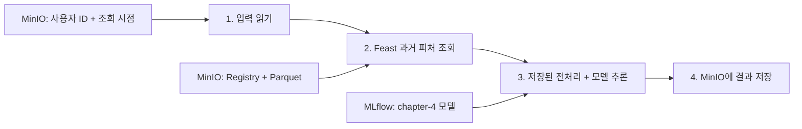

# Chapter 5 — 배치 추론 파이프라인

[교재 원본](https://github.com/practical-mlops/chapter-5)의 네 단계를 chapter-4 로컬 환경에 연결하는 실습이다. 기존에 학습한 RandomForest와 전처리 Pipeline을 그대로 불러온다. 이 문서는 KFP 배포 전 수행한 비교용 로컬 Python 실행 기록이다. 완료된 KFP 실습과 캡처는 [README](README.md)를 참고한다.

## chapter-4에서 이어지는 부분



- MinIO `127.0.0.1:19000`, MLflow `127.0.0.1:5001`, chapter-4 Python 3.10.17 venv를 재사용한다. 추가 패키지는 없다.
- 원본처럼 `get_historical_features`를 사용한다. Redis 온라인 조회와 materialize는 이 배치 경로에 필요하지 않다.
- 모델은 `chapter-4/experiments/results/result.json`에 기록된 URI로 고정한다. `--model-uri`로 다른 호환 모델을 지정할 수 있다.
- chapter-4 모델에는 OneHotEncoder가 포함되어 있다. 문자열 공백만 학습 때처럼 제거하며, 원본 코드의 `get_dummies`를 다시 적용하지 않는다.
- 예측 확률과 예측 클래스를 구분하고, 결과에 사용자 ID·조회 시점·모델 URI를 보존한다.

## 준비

아래 명령은 **저장소 루트**에서 실행한다. 기존 chapter-4 실습 데이터와 모델이 남아 있다면 서비스 시작만 필요하다.

```bash
docker compose -f chapter-4/experiments/feature_store/compose.yaml up -d --wait
bash chapter-4/experiments/start_mlflow_server.sh
```

MLflow 서버는 터미널을 유지한다. UI: http://127.0.0.1:5001
MinIO Console: http://127.0.0.1:19001 (`ch4local` / `ch4-local-only-password`).

MinIO에 피처와 Registry가 없다면 다른 터미널에서 다음을 실행한다.

```bash
chapter-4/venv/bin/python chapter-4/experiments/feature_store/run_lab.py prepare
chapter-4/venv/bin/python chapter-4/experiments/feature_store/run_lab.py apply
```

모델 아티팩트가 없다면 chapter-4 실험을 다시 실행하고, 새 `result.json`의 `model_uri`를 아래 명령에 `--model-uri`로 전달한다. 오래된 결과 파일의 URI를 새 모델로 자동 대체하지 않는다.

```bash
chapter-4/venv/bin/python chapter-4/experiments/income_experiment.py
```

## 실행과 관찰

한 번에 100명을 처리하려면:

```bash
chapter-4/venv/bin/python chapter-5/batch_inference.py all
```

직접 단계를 따라가려면 새 작업 폴더를 정해 같은 경로를 전달한다. `prepare`는 같은 폴더를 재사용하지 않는다.

```bash
chapter-4/venv/bin/python chapter-5/batch_inference.py prepare --work-dir chapter-5/outputs/my-first-batch --rows 100
chapter-4/venv/bin/python chapter-5/batch_inference.py read --work-dir chapter-5/outputs/my-first-batch
chapter-4/venv/bin/python chapter-5/batch_inference.py retrieve --work-dir chapter-5/outputs/my-first-batch
chapter-4/venv/bin/python chapter-5/batch_inference.py predict --work-dir chapter-5/outputs/my-first-batch
chapter-4/venv/bin/python chapter-5/batch_inference.py write --work-dir chapter-5/outputs/my-first-batch
chapter-4/venv/bin/python chapter-5/batch_inference.py verify --work-dir chapter-5/outputs/my-first-batch
```

VS Code에서는 `batch_inference_lab.ipynb`를 열고 chapter-4 venv 커널로 실행한다.

| 단계 | 확인할 파일 | 확인할 내용 |
|---|---|---|
| prepare | `request.parquet`, `manifest.json` | ID와 시점만 입력, 사용 모델과 데이터 해시 |
| read | `entities.parquet` | MinIO에서 읽은 입력 |
| retrieve | `features.parquet` | 조회된 8개 피처, null 여부 |
| predict | `predictions.parquet` | `probability_gt_50k`와 `predicted_label`의 차이 |
| write | MinIO `chapter5-batch/<batch_id>/predictions.parquet` | 업로드 후 다운로드한 바이트 일치 |
| verify | `verification.json` | 원천 값·직접 예측·사용자 순서 일치 |

## 검증의 의미

입력 CSV에는 사용자 ID가 없다. 실습 준비 단계에서 세 Parquet를 ID로 결합한 뒤 **전체 30,162행의 8개 피처가 CSV와 행별로 일치하는지** 검사하고, 검사를 통과한 데이터에서 샘플을 만든다. 이 확인은 교재 데이터에 한정된 대응 관계이며, 운영에서 행 번호를 사용자 ID로 사용하라는 의미가 아니다.

2023년 원천 데이터의 마지막 시각 직후를 조회 시점으로 사용한다. 오늘 날짜로 조회하면 365일 TTL 때문에 null이 나올 수 있다. 누락된 피처는 0으로 채우지 않고 추론 전에 실패시킨다.

이 검증은 저장소를 연결해도 피처와 예측이 보존되는지 확인한다. 샘플은 새 평가용 데이터가 아니므로 정확도나 일반화 성능을 측정하지 않는다. 기존 모델 성능은 chapter-4의 별도 테스트 결과를 참고한다.

## 다음 단계: Kubeflow

로컬 네 함수 `read → retrieve → predict → write`를 컨테이너 컴포넌트로 옮기고, Parquet 파일을 KFP Dataset artifact로 연결한다. 이후 클러스터 안에서 접근 가능한 MinIO·MLflow 주소와 Feast 설정을 사용해야 한다. 현재 설정의 `127.0.0.1`은 Pod 안에서는 각 Pod 자신을 가리킨다.

KFP YAML 컴파일·이미지 빌드/배포·클러스터 실행은 이번 로컬 실습에 포함되지 않았다. 원본의 모델 stage 및 별도 인코딩 방식 대신, 여기서 검증한 모델 URI와 저장된 전처리를 유지하는 것이 다음 단계의 기준이다.

서비스 중지는 `docker compose -f chapter-4/experiments/feature_store/compose.yaml stop`, MLflow 터미널은 Ctrl-C로 한다. 볼륨은 보존한다.

## 실행 확인 (2026-11-05)

[검증 결과](results/verification.json): 100명·8개 피처, 원천 값과 예측 라벨 일치, 확률 최대 오차 약 `1.11e-16`(허용 절대 오차 `1e-12`), MinIO 저장 파일 바이트 일치. 예측은 `<=50K` 78명, `>50K` 22명이었다. 이는 예측 분포이며 정답률이 아니다.

CLI 전체 실행과 노트북의 코드 셀 7개를 동일 Python 환경에서 순서대로 실행했다. Jupyter UI 자체는 검증하지 않았다. 입력 계약 테스트 3개도 통과했다.

```bash
chapter-4/venv/bin/python -m unittest discover -s chapter-5 -p 'test_*.py'
```
