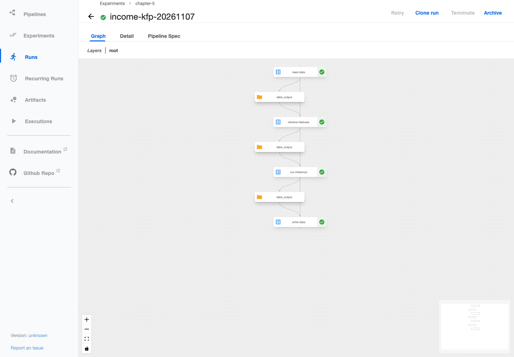
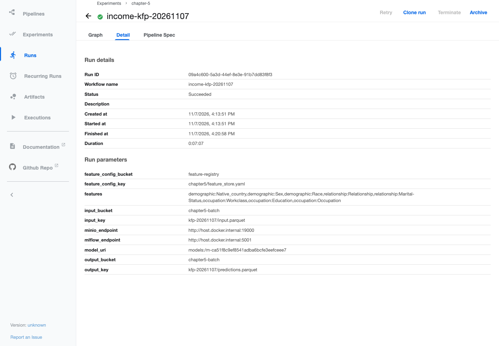
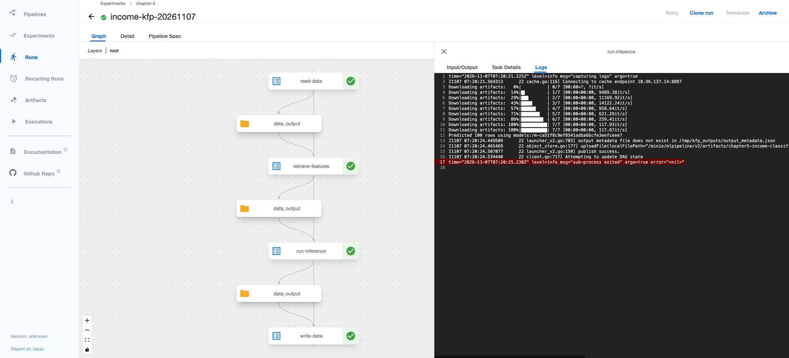
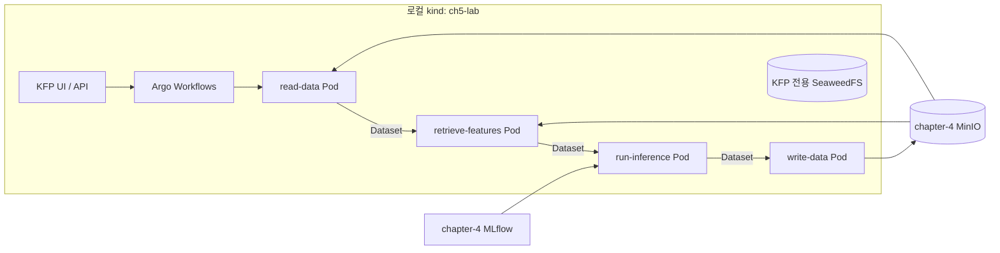

# Chapter 5 — 로컬 kind에서 KFP 배치 추론

## 실행 확인

[첫 KFP Run](http://127.0.0.1:8080/#/runs/details/09a4c600-5a3d-44ef-8e3e-91b7dd83f8f3)이 `SUCCEEDED`로 완료되었다. `read-data → retrieve-features → run-inference → write-data` 네 단계가 실제 Pod에서 성공했다.

- 100명 예측: `<=50K` 78명, `>50K` 22명.
- chapter-4 모델 직접 실행과 ID·조회 시점·라벨이 일치했다. 확률 최대 절대 차이는 `1.11e-16`이다.
- 최종 결과: `s3://chapter5-batch/kfp-20261107/predictions.parquet`.
- 증거: [예측 검증](results/kfp-verification.json), [단계별 상태](results/kfp-tasks.json). 전처리 단위 테스트 3개도 통과했다.
- KFP API·Pod 로그와 실제 UI의 Graph·Detail·추론 로그 화면을 확인했다.

UI에서 각 노드를 클릭해 로그를 따라가면 입력 100행, Feast 피처 8개 조회, 저장 모델 추론, 최종 업로드를 확인할 수 있다. 위 링크는 로컬 UI port-forward가 실행 중일 때 접근할 수 있다.

## 실습 결과


**파이프라인 DAG:** 네 컴포넌트의 성공 상태와 단계 사이 Dataset 전달 경로.



**Run 상세:** `Succeeded`, 실행 시간 7분 7초(최초 이미지 다운로드 포함), 모델 URI와 입출력 경로.



**추론 로그:** `Predicted 100 rows using models:/m-ca51f8c9ef8541adba6bcfe3eefceee7`과 artifact 저장 성공.



## chapter-4와 연결



- chapter-4의 원천 Parquet·모델·MLflow DB를 유지한다. 모델은 `experiments/results/result.json`의 URI로 고정하며 다시 학습하지 않는다.
- Pod에서 기존 Mac 서비스를 `host.docker.internal:19000`(MinIO), `host.docker.internal:5001`(MLflow)로 접근한다. 이는 **Docker Desktop 로컬 실습 주소**다.
- KFP 내부 중간 artifact는 클러스터의 SeaweedFS가 저장한다. 가이드의 호환 패치대로 KFP의 `minio-service` 이름은 유지한다.
- 배치에서는 과거 시점 조회를 사용하므로 Redis 온라인 적재는 필요하지 않다. chapter-5 전용 Feast 설정의 online store는 임시 SQLite이며 배치 조회에서 사용하지 않는다.

## 실행 순서

아래는 **저장소 루트**에서 실행한다. 명령의 kubeconfig와 context는 로컬 클러스터를 명시한다. EKS 기본 컨텍스트에 적용하지 않는다.

### 1. chapter-4 서비스

```bash
docker compose -f chapter-4/experiments/feature_store/compose.yaml up -d --wait
bash chapter-4/experiments/start_mlflow_server.sh
```

이미 실행 중이면 다시 띄우지 않는다. MLflow 터미널은 유지한다. 모델이 없는 환경에서는 [chapter-4 안내](../chapter-4/experiments/README.md)에 따라 학습하고 새 모델 URI를 입력 준비 단계에 `--model-uri`로 지정한다.

### 2. kind와 KFP 설치 — 최초 한 번

kind 0.27.0과 Kubernetes 노드 이미지 v1.31.6을 사용한다. 이 Mac은 Homebrew가 Xcode 라이선스 오류를 내므로 공식 바이너리를 실습 폴더에 둔다.

```bash
mkdir -p chapter-5/.cache/bin chapter-5/.kube
curl -fL https://github.com/kubernetes-sigs/kind/releases/download/v0.27.0/kind-darwin-arm64 -o chapter-5/.cache/bin/kind
curl -fL https://github.com/kubernetes-sigs/kind/releases/download/v0.27.0/kind-darwin-arm64.sha256sum -o chapter-5/.cache/bin/kind.sha256sum
# 다운로드한 checksum과 shasum 출력이 같은지 확인한 뒤 실행한다.
shasum -a 256 chapter-5/.cache/bin/kind
cat chapter-5/.cache/bin/kind.sha256sum
chmod +x chapter-5/.cache/bin/kind
chapter-5/.cache/bin/kind create cluster --config chapter-5/cluster/kind.yaml --kubeconfig chapter-5/.kube/config --wait 180s

git clone --depth 1 --branch 2.4.1 --filter=blob:none --sparse https://github.com/kubeflow/pipelines.git chapter-5/.cache/kfp-2.4.1
git -C chapter-5/.cache/kfp-2.4.1 sparse-checkout set manifests/kustomize

chapter-4/venv/bin/python -m venv chapter-5/.venv
chapter-5/.venv/bin/pip install -r chapter-5/requirements-kfp.txt
chapter-5/.venv/bin/python chapter-5/cluster/install_kfp.py
```

이미 존재하는 클러스터·다운로드 폴더는 다시 만들지 않는다. 설치 스크립트는 재실행할 수 있다. KFP 2.4.1의 오래된 MinIO 이미지는 SeaweedFS로, Argo controller와 executor는 같은 버전(v3.4.17)의 공식 quay.io 이미지로 패치한다. Apple Silicon에서 controller를 ARM64로 실행하도록 하며, 기본 이미지 실행 중 발생한 포트 바인딩 오류를 피한다. kind 설정은 이미지 병렬 다운로드를 활성화한다.

### 3. 이미지 적재와 Feast Job

```bash
docker build -t chapter5-inference:lab-v1 chapter-5
chapter-5/.cache/bin/kind load docker-image chapter5-inference:lab-v1 --name ch5-lab
kubectl --kubeconfig chapter-5/.kube/config --context kind-ch5-lab apply -f chapter-5/cluster/feast-job.yaml
kubectl --kubeconfig chapter-5/.kube/config --context kind-ch5-lab -n kubeflow wait --for=condition=complete --timeout=180s job/chapter5-register-features
kubectl --kubeconfig chapter-5/.kube/config --context kind-ch5-lab -n kubeflow logs job/chapter5-register-features
```

등록 Job을 다시 실행해야 한다면 기존 Job을 확인하고 제거한 후 apply한다. 원천 피처가 없다면 chapter-4의 `run_lab.py prepare`로 업로드한다. 이미지 변경 시 재빌드·재적재하고 새 태그로 파이프라인을 컴파일한다.

### 4. KFP UI 열기

별도 터미널에서 유지한다.

```bash
kubectl --kubeconfig chapter-5/.kube/config --context kind-ch5-lab -n kubeflow port-forward --address 127.0.0.1 svc/ml-pipeline-ui 8080:80
```

UI: http://127.0.0.1:8080 / 기존 MLflow: http://127.0.0.1:5001 / 기존 MinIO Console: http://127.0.0.1:19001

### 5. 입력 준비·컴파일·실행

입력 준비는 전체 원천 30,162행의 피처가 CSV와 일치하는지 확인하고, ID와 시점만 가진 100명 샘플을 만든다. 오래된 데이터의 TTL에 맞춰 2023년 조회 시점을 사용한다. `prepare` 작업 폴더와 출력 key는 실행마다 새 이름을 정한다.

```bash
chapter-4/venv/bin/python chapter-5/batch_inference.py prepare --work-dir chapter-5/outputs/kfp-20261107 --rows 100
chapter-5/.venv/bin/python chapter-5/inference_pipeline.py
chapter-5/.venv/bin/python chapter-5/submit_pipeline.py \
  --kfp-endpoint http://127.0.0.1:8080 \
  --minio-endpoint http://host.docker.internal:19000 \
  --mlflow-endpoint http://host.docker.internal:5001 \
  --manifest chapter-5/outputs/kfp-20261107/manifest.json \
  --output-key kfp-20261107/predictions.parquet \
  --record chapter-5/outputs/kfp-20261107/run.json --wait
```

SDK 제출도 UI에 실행 기록이 남는다. `Experiments → chapter-5 → Run`에서 네 단계가 순서대로 성공하는지 보고, 각 단계의 Logs와 Input/Output을 확인한다. `income_classifier_pipeline.yaml`은 UI에서 직접 업로드할 수도 있다. 캐시는 꺼 두었으므로 모든 단계가 실행된다.

### 6. 결과 검증

```bash
chapter-4/venv/bin/python chapter-5/verify_kfp.py \
  --record chapter-5/outputs/kfp-20261107/run.json \
  --output chapter-5/results/kfp-verification.json
```

KFP 성공 상태와 MinIO의 최종 결과를 확인한 뒤 직접 모델 예측과 비교한다. ID·시점·라벨은 정확히 일치해야 하고 확률은 병렬 계산의 부동소수점 오차를 고려해 절대 오차 `1e-12`를 허용한다. 이 검증은 파이프라인 연결 검증이며 모델 정확도를 새로 평가하는 것이 아니다.

## 상태 확인·종료

```bash
kubectl --kubeconfig chapter-5/.kube/config --context kind-ch5-lab -n kubeflow get pods
kubectl --kubeconfig chapter-5/.kube/config --context kind-ch5-lab -n kubeflow get workflows
```
