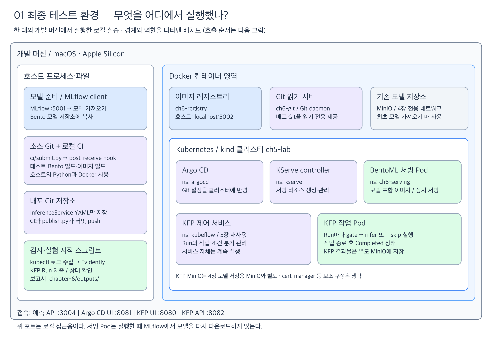
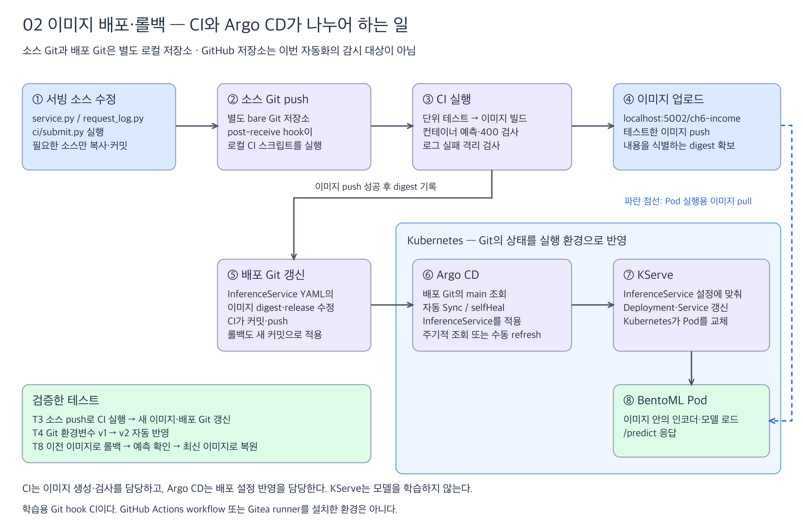
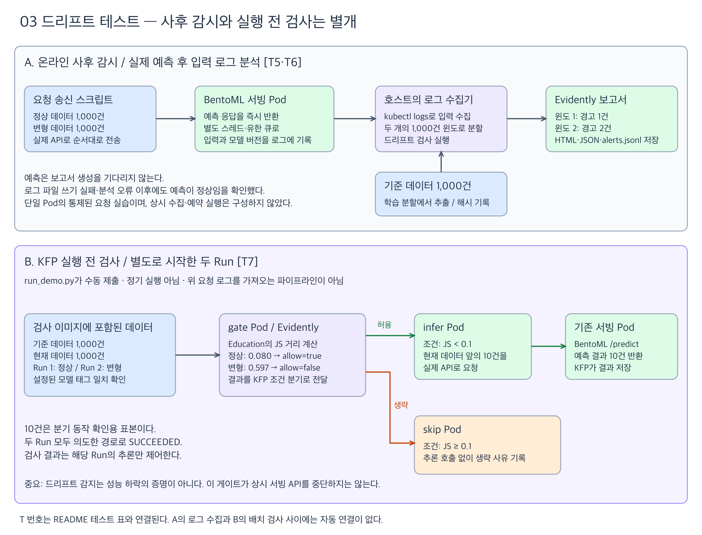

# Chapter 6 — 모델 서빙부터 배포·드리프트 검사까지

4장에서 학습한 **OneHotEncoder + RandomForest Pipeline**을 BentoML API로 만들고,
로컬 Kubernetes에서 배포·모니터링·롤백하는 과정을 실습했다.
책의 Yatai 배포 경로는 **KServe + Argo CD**로 대체했다. 모델 재학습은 수행하지 않았다.

이 문서는 **최종 환경 → 실제 진행 순서 → 검증한 구조와 결과**를 설명한다.
설치·실행 명령은 [RUNBOOK](RUNBOOK.md)에 분리했다.

## 1. 최종 테스트 환경



[Excalidraw 편집 원본](diagrams/ch6-test-environment.excalidraw)

개발 머신 한 대에서 Docker와 kind 클러스터 `ch5-lab`을 실행했다.
그림은 실행 위치를 나타내며, 구성 요소 사이의 호출 순서는 다음 두 도식에서 설명한다.

| 구성 요소 | 실행 위치·역할 | 이 실습에서 주의할 점 |
|---|---|---|
| MLflow / 4장 MinIO | 학습 모델의 원본과 실행 기록 제공 | 모델을 Bento에 가져올 때 사용. 최종 서빙 시 다운로드하지 않음 |
| BentoML | 모델·API 코드·라이브러리를 패키징하고 예측 요청 처리 | 서빙 이미지는 인코더와 모델을 함께 포함 |
| 로컬 CI | 호스트 Python·Docker에서 테스트와 이미지 빌드 | Git `post-receive` hook으로 시작하는 학습용 스크립트 |
| 이미지 레지스트리 | Docker `ch6-registry`, 호스트 `localhost:5002` | Kubernetes 노드가 이미지 digest를 기준으로 pull |
| Git 읽기 서버 | Docker `ch6-git` | 로컬 **배포 Git**을 네트워크로 제공. 소스 CI를 실행하는 서버가 아님 |
| Argo CD | Kubernetes `argocd` 네임스페이스 | 배포 Git의 YAML을 클러스터에 자동 반영 |
| KServe | Kubernetes `kserve` 네임스페이스 | `InferenceService`로부터 Deployment·Service를 생성·관리 |
| BentoML 서빙 Pod | Kubernetes `ch6-serving` 네임스페이스 | 예측 요청을 계속 받는 서비스 |
| Evidently 수집·분석 스크립트 | 호스트에서 Kubernetes 로그를 수집·분석 | 서빙 요청 처리와 별도로 실행 |
| KFP 제어 서비스 | Kubernetes `kubeflow` 네임스페이스, 5장 재사용 | Run의 작업과 조건 분기를 관리 |
| KFP 작업 Pod | Run마다 실행되는 `gate`, `infer` 또는 `skip` 작업 | 작업 완료 후 종료. 결과는 KFP의 별도 MinIO에 저장 |

Kubernetes는 1.31.6, KServe는 0.15.2의 `RawDeployment` 모드다.
이 모드는 일반 Deployment·Service를 사용하며, 이번 실습에서는 Ingress와 자동 확장을 연결하지 않았다.
Argo CD는 3.6.1, BentoML은 1.4.40, Evidently는 0.7.23을 사용했다.

## 2. 실제로 진행한 순서

처음부터 위 구성을 한 번에 만든 것이 아니라, 아래 순서로 작은 동작을 확인하며 확장했다.

| 순서 | 수행한 실습 | 확인한 내용 |
|---|---|---|
| 1 | MLflow에서 학습 Pipeline 로드 | 인코더·분류기가 함께 있고 예측 결과가 나옴 |
| 2 | Bento 모델 저장 → Bento 빌드 → 컨테이너 실행 | MLflow에 접근하지 않고 이미지 안의 모델로 예측, 입력 검증, 메모리 측정 |
| 3 | 로컬 Evidently 비교와 요청 로그 분석 | 기준·현재·변형 데이터 비교, 1,000건 윈도별 경고 생성 |
| 4 | 기존 Bento 이미지를 kind에 직접 넣어 KServe 배포 | `InferenceService`가 Deployment·Service를 만들고 API가 응답 |
| 5 | 로컬 이미지 레지스트리 연결 | 노드에 직접 이미지를 넣는 대신 레지스트리에서 digest로 pull |
| 6 | Argo CD와 별도 배포 Git 연결 | 환경변수 `gitops-v1 → gitops-v2` 변경이 새 Pod에 자동 반영 |
| 7 | 소스 Git push에 로컬 CI hook 연결 | 테스트 → 새 이미지 빌드·push → 배포 Git 갱신 → 자동 배포 |
| 8 | 새 이미지에서 Kubernetes 요청 로그 수집 | 요청 2,000건의 분포 검사, 로그·분석 실패와 예측 처리의 격리 확인 |
| 9 | 배포 Git으로 이전 이미지 지정 후 최신 이미지 복원 | 두 이미지에서 예측을 확인하고 롤백 경로 검증 |
| 10 | 별도의 KFP Run 두 개 실행 | 정상 데이터는 10건 추론, 변형 데이터는 추론 작업 생략 |

**환경변수 v2 테스트와 이미지 교체 테스트는 다르다.** 6번은 같은 이미지의 설정 변경,
7번은 CI가 만든 새 이미지로 교체, 9번은 이전 이미지로 복구하는 테스트다.

## 3. 소스 변경이 배포되는 구조



[Excalidraw 편집 원본](diagrams/ch6-delivery-flow.excalidraw)

| 저장소 | 들어 있는 것 | 누가 읽고 무엇이 시작되는가 |
|---|---|---|
| 이 프로젝트의 GitHub 원격 | 학습 코드·문서 | 기록 공유용. 이번 CI/Argo CD의 감시 대상이 아님 |
| `.cache/ci/source.git` | 서빙 코드·빌드 설정·테스트의 스냅샷 | push 후 hook이 [CI 스크립트](ci/run.py)를 실행 |
| `.cache/gitops/remote.git` | `income-service.yaml` | Argo CD가 `main`을 조회하고 자동 동기화 |

[ci/submit.py](ci/submit.py)는 필요한 소스만 별도 CI 저장소에 복사·커밋·push한다.
CI는 테스트한 이미지를 레지스트리에 올린 뒤, [배포 YAML](cluster/gitops/income-service.yaml)의
이미지 digest를 바꾸고 [publish.py](cluster/gitops/publish.py)로 배포 Git에 push한다.
이후 Kubernetes에 적용하는 주체는 Argo CD다.

Argo CD의 [Application 설정](cluster/gitops/application.yaml)은 자동 동기화와 `selfHeal`을 켜고
`prune`은 껐다. `refresh=hard`는 Git을 즉시 다시 조회하라는 요청이다.
이 값이 없어도 주기적으로 조회하지만, push 직후 새 Pod가 즉시 준비되는 것은 아니다.

롤백도 같은 경로를 사용한다. 이전 이미지 digest를 지정하는 **새 Git 커밋**을 만들고,
Argo CD 반영과 실제 예측을 확인한 뒤 최신 이미지로 복원했다.

## 4. 드리프트는 두 가지 별도 흐름으로 테스트했다



[Excalidraw 편집 원본](diagrams/ch6-drift-tests.excalidraw)

### A. 온라인 요청의 사후 모니터링

[cluster/drift_demo.py](cluster/drift_demo.py)가 정상 입력 1,000건과 변형 입력 1,000건을
실제 BentoML API로 전송했다. 호스트에서 Pod 로그를 읽어 두 윈도로 나눈 뒤,
각각 기준 데이터 1,000건과 비교했다. **이미 예측한 요청을 나중에 분석하는 흐름**이다.

기준 데이터는 최종 모델 학습에 사용한 train + validation에서 추출했다.
현재 데이터는 held-out test에서 추출했고, 변형 데이터는 현재 데이터의 80% 행에
`Education=Masters`를 지정해 만들었다. 실제 Masters 비율은 81.1%가 되었다.

| 윈도 | 입력 | 감지한 피처 |
|---|---|---|
| 1 | 정상 데이터 1,000건 | `Native_country` — JS 약 0.123 |
| 2 | 변형 데이터 1,000건 | `Native_country` — 약 0.123, `Education` — 약 0.597 |

모든 피처는 범주형이며 피처별 Jensen–Shannon 거리 임계값은 0.1이다.
이 표의 경고는 데이터셋 전체 판정 기준인 드리프트 피처 비율 0.5와 별개다.
수집한 2,000건이 전송한 CSV와 일치하는지, 모델 태그·MLflow URI·기준 데이터 해시가
맞는지도 검증했다. 분석 오류가 발생해도 예측 API는 계속 응답했다.

### B. KFP 배치 작업의 실행 전 게이트

[pipeline/run_demo.py](pipeline/run_demo.py)가 정상·변형 데이터를 대상으로 Run을 하나씩
**수동 제출**했다. 예약 실행은 설정하지 않았다. 이 파이프라인은 A에서 모은 로그를
읽지 않고, 별도 검사 이미지에 포함한 기준·현재 CSV를 사용한다.

1. `gate` Pod가 Evidently로 비교하고 `allow` 값을 출력한다.
2. KFP의 `dsl.If / dsl.Else`가 해당 분기의 작업만 실행한다.
3. 허용하면 `infer` Pod가 기존 BentoML API에 **앞의 10건**을 요청한다.
4. 허용하지 않으면 `skip` Pod가 생략 사유만 기록한다.

| Run | Education JS 거리 | 조건 분기 | 실제 확인한 결과 |
|---|---:|---|---|
| current | 0.080495 | `allow=true` | `infer` 성공, 실제 예측 요청 10건 |
| shifted | 0.597173 | `allow=false` | `infer` 실행 생략, `skip` 성공 |

두 Run 모두 의도한 분기를 실행해 `SUCCEEDED`로 종료했다.
**10건은 분기 동작 확인용 표본**이며, 1,000건 전체 배치 추론으로 확장하는 테스트는 하지 않았다.
`Education ≥ 0.1`이라는 중단 기준도 이번 실습 정책이다. 드리프트가 모델 성능 하락을
증명하는 것은 아니며, 이 게이트가 상시 서빙 API를 중단하지도 않는다.

## 5. 어떤 테스트를 완료했는가

아래 T 번호는 도식의 검증 표시와 대응한다. 현재 상태와 과거 실행 증거를 대조한 점검 결과다.
실행 기록을 검사할 때에는 전체 파이프라인을 다시 돌리지 않고, API·단위 테스트·KFP 상태를
재확인하고 저장된 원본 로그와 배포 이력을 비교했다.

| ID | 검증한 대상 | 통과 근거 | 코드·재실행 안내 |
|---|---|---|---|
| T1 | 모델 패키징 | 인코더·모델 포함, 호스트 모델 마운트 없이 컨테이너 예측. 모델 파일 약 6 MiB, 로딩 RSS 증가 약 33 MiB | [모델 가져오기](import_model.py), [메모리 측정](inspect_memory.py), [실행 안내](RUNBOOK.md#serving) |
| T2 | 예측 API·입력 검증 | 서로 다른 두 요청에 예측 0/1, 필수 입력 누락에 HTTP 400 | [API 테스트](ci/smoke.py) |
| T3 | 소스 push 기반 CI | 단위 테스트 2개, 컨테이너 검사, 이미지 push, 배포 Git 갱신 성공. 현재 소스와 테스트한 소스 일치 | [CI 실행](ci/run.py), [실행 안내](RUNBOOK.md#local-ci) |
| T4 | KServe·Argo CD 배포 | 생성된 Deployment의 owner가 InferenceService. 환경변수 v2 반영, digest 이미지 pull, `Synced / Healthy`, `Ready=True` | [현재 배포 검사](cluster/gitops/verify_deployment.py), [실행 안내](RUNBOOK.md#gitops) |
| T5 | 드리프트 비교·수집 | 요청 2,000건과 CSV 일치, 윈도별 경고 1건/2건, 기준 해시·모델 버전 일치 | [수집·검사](cluster/drift_demo.py), [실행 안내](RUNBOOK.md#cluster-monitoring) |
| T6 | 모니터링 실패 격리 | CI에서 로그 파일 쓰기 실패를 유발해도 예측 성공. 별도 분석 스키마 오류 후 API 예측 성공 | [단위 테스트](ci/test_service.py), [요청 로그](request_log.py), [수집·검사](cluster/drift_demo.py) |
| T7 | KFP 조건 분기 | current의 `infer` 성공 / shifted의 `skip` 성공. 실제 실행 로그로 10건 호출·0건 호출 확인 | [KFP 실행·검사](pipeline/run_demo.py), [실행 안내](RUNBOOK.md#kfp-gate) |
| T8 | 이미지 롤백·복원 | 서로 다른 두 digest로 Git 배포. 이전·최신 이미지에서 각각 실제 예측 확인 | [롤백 테스트](cluster/gitops/rollback_demo.py), [실행 안내](RUNBOOK.md#rollback) |

### 남아 있는 실행 증거

`outputs/`와 `.cache/`는 로컬 산출물이며 Git에 올리지 않는다. 다른 머신에서는 재실행해야 한다.
경로는 이 `chapter-6` 디렉터리 기준이다.

| 증거 | 로컬 위치 또는 식별자 |
|---|---|
| CI 단계별 로그·컨테이너 로그·결과 | `.cache/ci/jobs/`, `.cache/ci/latest.json` |
| 실제 입력 로그·Evidently HTML/JSON·경고 | `outputs/cluster-20261107T201400330352Z/` |
| KFP 컴파일 결과·API 작업 상태 | `outputs/kfp-gate-20261107T201917/` |
| current Run ID | `2c969ebb-22ee-48e2-85c6-7e2dc19652ef` |
| shifted Run ID | `2a25077f-f63e-48aa-8de3-d26394bb7597` |
| 롤백 전후 이미지·Git revision·예측 | `outputs/rollback-verification.json` |
| 통합 검증 기록 | `outputs/final-verification.json` |

### 완료 범위에 포함하지 않은 것

- Yatai 자체 설치·배포: KServe·Argo CD 경로로 대체했다.
- CI 테스트 실패 시 배포 Git과 클러스터가 유지되는지 확인하는 별도의 실패 시나리오 종단간 테스트.
- 예약 모니터링, 상시 로그 수집기, 다중 Pod 로그 병합·유실 복구, 부하·자동 확장 테스트.
- 모델 성능 하락 검증, 자동 재학습·자동 모델 교체, 실제 운영 환경의 인증·승인 절차.

CI 스크립트는 단계 실패 시 중단하도록 구현했지만, 위에 적은 모든 실패 상황을
별도 실험으로 검증한 것으로 취급하지 않는다.

## 6. 다시 실행하거나 도식을 수정하려면

전체 명령은 [RUNBOOK](RUNBOOK.md)에 있다. 이미 완료한 실습을 확인하려면 먼저
API 검사와 현재 배포 검사만 실행하면 된다. CI 재빌드·롤백·KFP 제출은 상태를 바꾸거나
새 작업을 만들므로 필요한 단계만 선택한다.

```bash
# 3004 예측 API 포트 포워딩이 실행 중일 때
chapter-6/.venv/bin/python chapter-6/ci/smoke.py \
  --endpoint http://127.0.0.1:3004 --sample chapter-6/sample_request.json
chapter-6/.venv/bin/python chapter-6/cluster/gitops/verify_deployment.py
```

도식은 PNG 미리보기와 편집 가능한 `.excalidraw` 파일을 함께 저장했다.
Excalidraw에서 원본을 열어 수정한 뒤 PNG도 다시 내보내면 GitHub README에 반영된다.
그림은 최종 검증 당시의 구성을 나타내며, 로컬 포트 포워딩이 항상 실행 중임을 보장하지 않는다.
