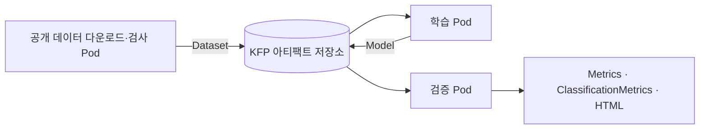

# Chapter 7 — 데이터 분석과 준비

학습 전에 데이터를 확보하고, 검사하고, 품질 검사나 모델 학습 같은 후속 단계에 전달하는 방법을 다룬다.
예를 들어 이 장의 MovieLens 실습에서는 준비 Pod가 만든 데이터셋을 별도 QA Pod에 전달해 결측·중복 등을 검사한다. COCO128 실습에서 준비한 이미지·라벨·분할 명세는 8장의 로컬 모델 학습에 입력으로 사용할 수 있다.

## 시작하기

이 장의 환경과 실행 명령은 [RUNBOOK](RUNBOOK.md), 결과는 [RESULTS](RESULTS.md)에 정리했다. `chapter-7/.venv`와 `chapter-7/requirements.txt`를 사용한다.

## 실습 범위와 목표

스터디 7장은 KFP 데이터 전달(7.2), 객체 탐지 데이터 준비(7.3.1), 영화 추천 데이터 준비(7.3.2)를 다룬다. 로컬 실습은 공개 데이터셋 도전 과제에 맞춰 COCO128을 사용한다. 책의 신분증 데이터와 데이터 규모·클래스 구성이 다르다.

- 입력 데이터의 형식·분할·출처를 명세로 남긴다.
- 서로 다른 Pod 사이에서 Parameter와 Dataset 아티팩트가 전달되는 과정을 확인한다.
- 이미지 데이터와 표 데이터의 품질 검사 기준을 비교한다.

### 이 장에서 정확히 확인하려는 것

목표는 **원본 데이터를 다음 작업이 읽을 수 있는 형태로 만들고, 다른 Pod에서도 그 결과를 받아 검사할 수 있음을 확인하는 것**이다. 데이터 다운로드에 성공하는 것만으로 준비가 끝나지는 않는다. 사용할 파일과 스키마, train/validation/test 분할, 출처와 검사 결과까지 정해져 있어야 한다.

현재 실습은 다음 두 경로로 나뉜다. 두 데이터셋을 서로 연결하거나, 7장에서 모델을 학습하는 구조는 아니다.

| 실습 | 입력 → 수행 작업 → 출력 | 확인하려는 것 |
|---|---|---|
| COCO128 로컬 준비 | 공개 ZIP → 이미지·라벨 검사와 분할 → 이미지·라벨 디렉터리, `data.yaml`, `manifest.json` | 객체 탐지 학습 코드가 읽을 수 있는 데이터의 조건 |
| MovieLens KFP 준비·QA | 공개 ZIP → 준비 Pod의 Parquet 변환·분할 → Dataset 전달 → QA Pod의 검사와 HTML 보고서 | 준비 결과가 Pod 경계를 넘어 전달되고, 소비하는 단계에서도 검사 가능한지 |

KFP는 이 과정의 **작업 순서, Pod 실행, 아티팩트 전달과 실행 상태 기록**을 담당한다. 어떤 열이 필요한지, 어떻게 분할할지, 무엇을 오류로 볼지는 컴포넌트의 Python 코드가 정한다. `Dataset` 타입을 지정하는 것만으로 전처리나 품질 검사가 수행되지는 않는다.

## KFP에서 데이터가 이동하는 방식

KFP 컴포넌트는 서로 다른 Pod에서 실행된다. 첫 Pod에서 `/tmp/images`에 저장했다고 해서 다음 Pod의 같은 경로에 파일이 생기지는 않는다. 다음 단계에 무엇을 전달하는지 구분해야 한다.

| 전달 방식 | 전달하는 내용 | 이번 실습 예 |
|---|---|---|
| Parameter | 작고 직렬화 가능한 값 | seed, epochs, 이미지 개수 |
| Artifact | 파일·디렉터리와 타입·URI·메타데이터 | 데이터셋, 학습 가중치, 보고서 |
| PVC | 여러 Pod가 마운트하는 볼륨 | 9장의 데이터·체크포인트·이벤트 로그 |

아티팩트를 사용하면 준비 Pod가 `Output[Dataset].path`에 쓰고 KFP가 저장소에 보관한다. 학습 Pod는 `Input[Dataset].path`로 가져온 파일을 읽는다. 두 경로 문자열이 같다는 보장은 없다. 데이터 YAML에 기록된 절대 경로도 소비하는 Pod의 실제 경로로 다시 맞춰야 한다.

7장에서 실제 실행하는 파이프라인은 `prepare_movie → inspect_movie`다. 준비 Pod가 만든 Dataset을 QA Pod가 입력으로 받으며, QA가 실패하면 Run도 실패한다. 아래 학습·검증 흐름과 타입 표는 이를 **8장의 객체 탐지 파이프라인으로 확장한 예**이며, 구현은 [8장 pipeline.py](../chapter-8/pipeline.py)에 있다.



| KFP 타입 | 역할 | 구현 위치 |
|---|---|---|
| Dataset | 이미지·라벨·분할 명세 | prepare_data |
| Model | 학습 가중치와 실행 기록 | fit_model |
| Metrics | mAP·precision·recall | score_model |
| ClassificationMetrics | 실제/예측 범주별 혼동 행렬 | score_model |
| HTML | 데이터 QA와 평가 보고서 | prepare_data, score_model |

`Artifact`는 일반 타입이고, 위 타입들은 목적을 구분한다. 타입을 붙이는 것만으로 데이터 품질 검사가 실행되지는 않는다. 대용량 파일을 경로로 전달해도 소비하는 코드가 전부 메모리에 올리면 메모리 사용량은 여전히 커진다.

## 공개 데이터 준비 도전 과제

[lab_data.py](lab_data.py)는 다운로드 → 라벨 검사 → 분할 → 명세 기록을 실행한다.

- COCO128의 이미지 128장을 seed 42로 섞고 train 96장, validation 16장, test 16장으로 나눈다.
- 라벨의 클래스 ID와 정규화 좌표를 검사한다. 객체가 없는 이미지에는 빈 라벨을 허용한다.
- 이미지 SHA256으로 분할 간 중복을 확인하고, 원본 ZIP·이미지·라벨 해시를 명세에 남긴다.
- YOLO용 `data.yaml`과 `manifest.json`을 생성한다.

### 어떤 상태여야 준비된 데이터인가

학습 코드에 전달하는 단위는 이미지 폴더 하나가 아니라 다음 구조를 갖춘 데이터셋 디렉터리다.

```text
coco128/
├── images/{train,val,test}/*.jpg
├── labels/{train,val,test}/*.txt
├── data.yaml
└── manifest.json
```

- 이미지와 라벨은 같은 파일 이름을 사용한다. 예를 들어 `images/train/example.jpg`의 라벨은 `labels/train/example.txt`다.
- 라벨 한 줄은 `class_id x_center y_center width height`다. 클래스 ID는 0~79의 정수이고 좌표·크기는 이미지 너비와 높이로 정규화한 0~1 범위 값이다.
- `data.yaml`은 데이터 루트, 각 분할의 이미지 경로와 클래스 이름을 지정한다. `manifest.json`은 출처 URL, seed, 원본 ZIP 해시와 분할별 파일·해시를 기록한다.
- train 96장, validation 16장, test 16장이 존재하고 분할 간 이미지 SHA256 중복이 없어야 한다. train은 학습, validation은 모델 비교·선택, test는 선택 이후 최종 평가에 사용한다.

현재 코드는 원본 라벨 파일이 없으면 빈 라벨로 처리한다. 따라서 실무 데이터에 적용할 때는 실제로 객체가 없는 이미지인지, 주석 파일이 누락된 것인지 추가로 확인해야 한다. 현재 검사는 이미지 디코딩이나 주석의 의미적 정확성까지 보장하지 않는다.

이 결과는 8장 로컬 학습의 `--dataset` 입력으로 전달할 수 있다. 다만 현재 8장 KFP 파이프라인은 `prepare_data` Pod에서 데이터를 다시 내려받아 준비한다. 로컬 `chapter-7/outputs/` 경로를 전달하는 것만으로 그 파일이 클러스터에 올라가지는 않는다. 이미 준비한 파일을 KFP에서 재사용하려면 클러스터가 접근할 수 있는 저장소에 두고 Dataset으로 가져오거나 PVC에 적재하는 단계를 별도로 연결해야 한다.

COCO128 기본 YAML은 학습과 검증에 같은 이미지를 사용하므로 그대로 평가하지 않는다. 이번 분할은 이미지 중복을 막지만, 사전 학습 가중치가 COCO를 이미 봤을 가능성은 제거하지 못한다. 작은 연결 실습이며 새로운 도메인의 일반화 성능 평가로 해석하지 않는다.

실행 명령과 결과 확인 절차는 [7장 실행 안내](RUNBOOK.md)에 정리했다.

## 영화 추천 데이터 준비 — 실행 결과

7.3.2의 핵심은 MovieLens 다운로드 → 압축 해제 → CSV를 Parquet로 변환 → train/validation/test 분할 → 저장 → QA다. 열 기반 저장 형식의 장점과 필요한 열만 읽는 방법을 정리한다.

### KFP에서 무엇을 입력받고 무엇을 확인하는가

이 파이프라인은 사용자가 미리 준비한 로컬 파일을 받지 않는다. `prepare_movie`가 MovieLens 원본을 직접 내려받아 준비하고, `inspect_movie`가 그 출력만으로 검사한다.

| 단계 | 수행 내용 | 출력·통과 기준 |
|---|---|---|
| `prepare_movie` | `ratings.csv`에서 seed 42로 6,400행을 무작위 추출하고 80/10/10으로 분할 | Dataset 디렉터리에 `train.parquet` 5,120행, `val.parquet` 640행, `test.parquet` 640행과 `manifest.json` 저장 |
| KFP 아티팩트 전달 | 준비 단계의 `dataset` 출력을 QA 단계의 `dataset` 입력에 연결 | QA Pod가 자신의 `Input[Dataset].path`에서 파일을 읽음 |
| `inspect_movie` | 세 파일을 읽어 스키마·결측·값 범위·중복·행 수 검사 | 검사 통과 시 HTML 보고서 생성, 조건 위반 시 작업 실패 |

Parquet의 열은 `userId`, `movieId`, `rating`, `timestamp` 순서다. QA는 결측이 없고, 평점이 0.5~5 범위이며, ID와 timestamp가 양수인지 확인한다. 각 분할 내부와 분할 사이에 같은 `(userId, movieId)` 쌍이 중복되지 않아야 한다. 같은 사용자가 서로 다른 영화에 남긴 평점까지 제거하는 것은 아니다.

validation/test에 학습 데이터에 없던 사용자 또는 영화가 등장하는 행은 개수를 보고하고 유지한다. 이 Run의 성공은 **데이터 준비·전달·검사가 완료됐음**을 뜻한다. 추천 모델의 학습 성공이나 예측 성능, 시간 순서에 따른 평가의 타당성을 뜻하지 않는다. 9장 추천 코드는 현재 자체적으로 데이터를 준비하므로, 이 Dataset이 자동으로 9장에 연결되지는 않는다.

[movie_data_pipeline.py](movie_data_pipeline.py)로 소형 데이터의 Parquet 변환·분할과 별도 QA를 KFP에서 실행했다. 준비·QA 두 작업이 성공했고 스키마·결측·중복·평점 범위·분할 행 수 검사를 통과했다. 사용자·영화 ID의 분할 간 중복은 이미지 중복과 의미가 다르므로 무조건 제거하지 않는다. 시간 분할과 무작위 분할이 답하는 질문도 구분한다.

현재 [영화 평점 코드](../chapter-9/recommend.py)는 소형 데이터를 내려받아 분할하고 학습하는 구현이다. 이 코드와 별도로 데이터 준비 파이프라인을 실행했으며, [실습 결과](RESULTS.md)에 Run ID와 QA 수치를 기록했다.

## 정리

학습 코드보다 먼저 입력 계약을 정한다. 객체 탐지에서는 이미지와 라벨의 짝·좌표·클래스·분할 중복을 확인하고, 표 데이터에서는 스키마·결측·중복·분할 기준을 확인한다. 영화 추천처럼 사용자와 시간 정보가 있는 데이터는 무작위 분할과 시간 순서 분할이 서로 다른 질문에 답한다는 점도 함께 기록해야 한다.

## 참고

- [COCO128 공식 데이터 설명](https://docs.ultralytics.com/datasets/detect/coco128/)
- [KFP 아티팩트 공식 문서](https://www.kubeflow.org/docs/components/pipelines/user-guides/data-handling/artifacts/)
- [책의 객체 탐지 데이터 준비 코드](https://github.com/practical-mlops/object-detection-project)
