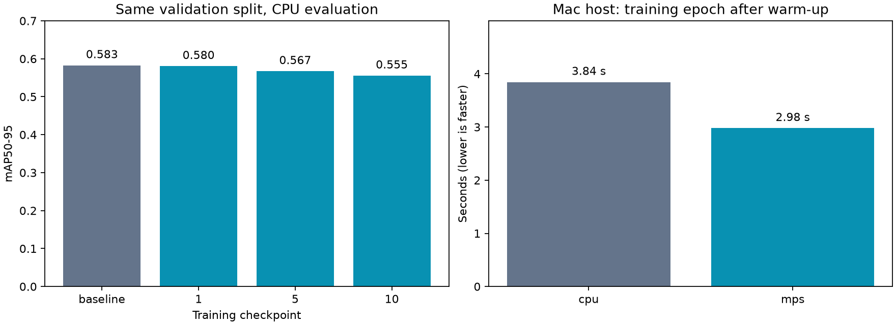

# Chapter 8 — 실습 결과

환경 분리 전 실행한 증거를 이 장에서 찾아볼 수 있도록 정리했다. 환경 분리 후 재검증 내역은 별도로 표시한다.

Artifact 학습 Run `a74a32fe-ee00-41ba-a5d0-03ff20afe042`는 준비·학습·검증 모두 성공했다. 기본/1/5/10 epoch validation mAP50-95는 0.5825/0.5804/0.5670/0.5554다. CPU/MPS 3 epoch 전체 시간은 14.80/18.63초였다. 단일 측정으로 일반화하지 않는다.

[수치·측정 조건](results/yolo-summary.json)

통합 실습 당시의 상세 설명은 [기존 7~9장 기록](../chapter-9/RESULTS.md)에 보존했다.

## 환경 분리 후 검증

이 장의 가상환경에서 파이프라인 컴파일과 1 epoch CPU 학습·검증을 실행해 통과했다. 이후 전용 이미지 빌드·KFP 재제출도 완료했다. 아래 새 실행 기록을 참고한다.

[환경 검증 기록](results/environment-check.json)

## 전용 이미지로 KFP 재실행 — 2026-11-15 KST

각 장의 requirements와 Dockerfile로 이미지를 빌드·등록하고 digest로 고정해 실행했다. 첫 빌드는 패키지 다운로드 중 읽기 시간 초과로 실패했고, pip timeout을 120초로 늘린 재시도에서 성공했다. 실패·성공 빌드 로그는 로컬 `outputs/separate-kfp/`에 보존했다.

| 실습 | 새 Run ID | 결과 |
|---|---|---|
| artifacts | `3aa34a9d-e6de-463d-a950-ec62581a9622` | 모든 필수 작업 SUCCEEDED |

[실행 이미지 digest](results/separate-kfp/image.txt)를 실제 Pod 이미지와 대조했다.

- [artifacts 작업·이미지 검증](results/separate-kfp/artifacts-verification.json)
