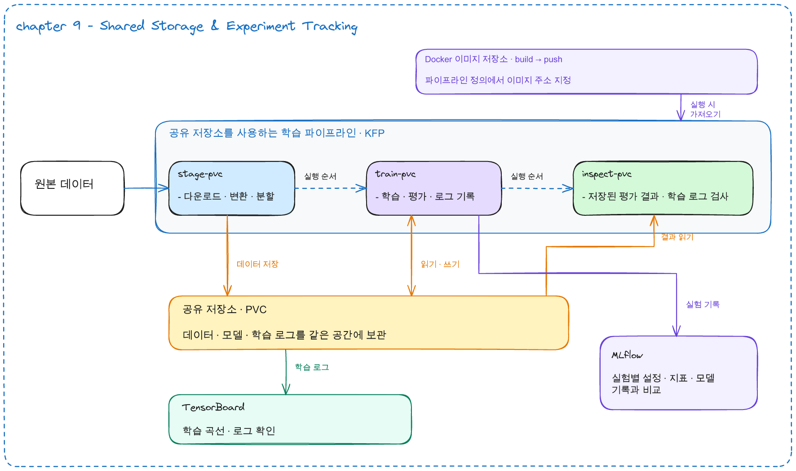
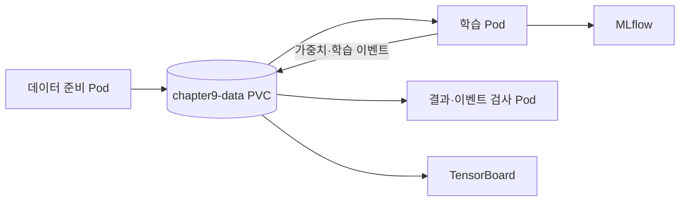

# Chapter 9 — PVC와 학습 추적

데이터를 Pod마다 다시 옮기는 비용과, 학습 결과를 나중에 재현·비교하는 문제를 다룬다. 이번 실습에서는 7~8장 파이프라인에 PVC·TensorBoard·MLflow를 연결하고, 영화 평점 예측도 작은 데이터로 실행한다.

## 아키텍처



[Excalidraw 원본](../diagrams/ch9-storage-tracking.excalidraw)

## 시작하기

이 장의 환경과 실행 명령은 [RUNBOOK](RUNBOOK.md), 결과는 [RESULTS](RESULTS.md)에 정리했다. `chapter-9/.venv`와 `chapter-9/requirements.txt`를 사용한다.

## 실습 범위와 목표

스터디의 이번 주차 범위는 9.1 PVC를 이용한 데이터 관리다. 원문에서 9.2 TensorBoard와 9.3 영화 추천 학습은 다음 주차 예정으로 표시되어 있다. 이 저장소에는 해당 확장 실습 코드도 함께 준비되어 있다.

- 7~8장의 아티팩트 전달 방식과 PVC 공유 방식의 차이를 확인한다.
- 실행 순서·저장 경로·데이터 유지 기간을 명시한다.
- 확장 실습에서 학습 로그와 모델을 실행 단위로 추적한다.

설치·실행 명령은 [RUNBOOK](RUNBOOK.md)에 분리했다. Notion에 기록된 리모트 서버 주소·사양·실행 시간은 이 Mac 환경의 실행 결과로 사용하지 않는다.

### 이 장에서 정확히 확인하려는 것

핵심 목표는 **여러 Pod가 같은 파일을 사용할 때 저장 위치·실행 순서·삭제 시점을 관리하고, 남은 모델과 로그를 실행 기록에 연결하는 것**이다. 8장에서 확인한 학습·검증 흐름에 저장과 추적 관점을 더한다.

| 실습 | 입력 → 수행 작업 → 출력 | 확인하려는 것 |
|---|---|---|
| PVC 생명주기 | 실행별 전용 PVC → 파일 쓰기·다른 Pod의 읽기·해시 대조·삭제 요청 | Pod가 달라도 파일을 읽을 수 있고, 사용 후 리소스 정리까지 확인할 수 있는지 |
| PVC 학습 | 기존 `chapter9-data` PVC와 실행 폴더 이름 → 데이터 준비·학습·로그 검사 | 동일 볼륨을 공유하면서 실행별 결과를 구분할 수 있는지 |
| TensorBoard·MLflow 확장 | 학습 중 생성한 이벤트·설정·지표·모델 → 화면에서 조회 | 어떤 실행이 어떤 결과를 만들었는지 설명할 수 있는지 |
| 영화 평점 예측 확장 | MovieLens 평점 → 학습·validation 선택·test 평가 → 모델과 RMSE | 다른 학습 작업에도 실행 추적과 기준 모델 비교를 적용할 수 있는지 |

PVC 생명주기 실습과 PVC 학습은 별개다. 전자는 작은 전용 PVC를 만들고 삭제하는 실험이고, 후자는 TensorBoard가 계속 읽을 수 있도록 미리 만든 PVC를 유지한다. 이 실습은 아티팩트 방식보다 PVC가 얼마나 빠른지 측정하는 벤치마크는 아니다.

## 아티팩트와 PVC를 선택하는 기준

아티팩트는 작업 입출력·타입·메타데이터를 남기기 편하다. 반면 파일이 많거나 단계마다 같은 데이터에 접근하면 전송 비용이 커질 수 있다. PVC는 여러 Pod에서 볼륨을 마운트해 파일을 공유하는 방식이다.



| 항목 | 이번 실습의 선택 |
|---|---|
| PVC | 기존 kind의 standard StorageClass, 3Gi, ReadWriteOnce |
| 작업 격리 | 실행별 고유 디렉터리에 데이터·가중치·로그 저장 |
| 실행 순서 | 준비 작업이 반환한 경로를 학습이 받고, 학습 결과 경로를 검사 작업이 받음 |
| 유지 기간 | TensorBoard 확인을 위해 PVC를 유지하고 수동 정리 |
| 평가 결과 | Metrics·HTML 아티팩트로 KFP에도 기록 |

같은 볼륨을 마운트했다는 사실만으로 작업 순서가 정해지지는 않는다. 명시적인 의존 관계가 필요하다. 이번 단일 노드의 ReadWriteOnce 구성을 여러 노드에서 동시에 읽고 쓸 수 있는 구성으로 일반화하지 않는다. PVC를 삭제하면 실행 로그도 사라질 수 있으므로 필요한 모델·지표는 별도로 보관해야 한다.

### 데이터와 경로는 어떻게 준비하는가

PVC 학습을 시작하려면 `cluster.yaml`의 PVC가 사용 가능한 상태여야 하고, 각 Pod가 이를 `/shared`에 마운트해야 한다. 입력 `run_folder`는 다른 실행과 겹치지 않는 이름을 사용한다. 데이터 준비 함수는 비어 있지 않은 출력 디렉터리를 거부하므로 기존 실행 폴더를 그대로 재사용하지 않는다.

```text
/shared/<run_folder>/
├── dataset/                # 이미지·라벨, data.yaml, manifest.json
└── training/
    ├── model.pt            # 마지막 학습 체크포인트의 사본
    ├── result.json         # 평가 결과, 시간, MLflow Run ID
    ├── fit/                # 학습 체크포인트와 기록
    ├── eval/               # validation 평가 결과
    └── tensorboard/        # epoch별 손실·시간 이벤트
```

| KFP 단계 | 입력 | 수행 작업과 다음 단계에 넘기는 값 |
|---|---|---|
| `stage_pvc` | 실행 폴더 이름, seed | COCO128을 내려받아 `/shared/<run_folder>/dataset`에 준비하고 실행 루트 경로 반환 |
| `train_pvc` | 준비 단계가 반환한 루트, epoch 수, MLflow 주소 | 같은 PVC의 데이터로 CPU 학습·validation 평가를 수행하고 `training` 경로 반환 |
| `inspect_pvc` | 실행 루트와 학습 결과 경로 | `result.json`과 TensorBoard 이벤트를 읽고 `train/box_loss` 존재 확인, KFP Metrics·HTML 기록 |

여기서 전달되는 문자열 경로는 Parameter다. **파일을 전달하는 것은 경로 문자열이 아니라 모든 단계가 마운트한 같은 PVC**다. 준비·학습의 반환값을 다음 작업의 입력으로 연결해 실행 순서도 정한다.

현재 `inspect_pvc`는 모델을 다시 로드해 별도로 검증하지 않는다. 학습 함수 안에서 수행한 validation 결과를 읽고 이벤트 로그를 검사한다. 8장의 `score_model`이 별도 Pod에서 모델을 다시 평가하는 구조와 이 점이 다르다.

7·8장의 코드는 컨테이너 빌드에 재사용하지만 이전 장의 실행 결과가 자동으로 연결되지는 않는다. `stage_pvc`가 이 실행의 데이터를 새로 준비하며, 초기 가중치도 9장 이미지에 포함한 파일을 사용한다. Python 환경과 이미지는 장별로 분리하고 클러스터·MLflow 서버 같은 공용 인프라는 재사용한다.

## PVC 생명주기 — 실행 결과

현재 구현은 [cluster.yaml](cluster.yaml)로 PVC를 미리 만들고 각 작업이 마운트한다. 책의 `CreatePVC → 작업 → DeletePVC` 흐름과는 생성·정리 주체가 다르다.

[pvc_lifecycle.py](pvc_lifecycle.py)에서 전용 PVC 생성 → 파일 쓰기 → 다른 Pod에서 해시 대조 → 삭제 요청을 실행했고 네 작업 모두 성공했다. 내장 CreatePVC는 캐시 fingerprint 오류로 실패해 일반 KFP 컴포넌트의 Kubernetes API 호출로 대체했다.

삭제 요청 뒤 PVC가 `Terminating`으로 남는 현상도 재현했다. 이 볼륨을 참조하는 완료 Pod 두 개의 로그를 저장하고 해당 Pod를 정리한 뒤 PVC와 PV가 사라진 것을 확인했다. Run ID·오류·증거는 [실습 결과](RESULTS.md)에 기록했다.

TensorBoard가 읽을 학습 로그는 확인이 끝날 때까지 유지한다. PVC 삭제 전 필요한 모델과 로그를 보관하고, 삭제 요청 후 실제 리소스 정리 여부까지 확인한다.

## TensorBoard와 MLflow의 역할 — 확장 실습

TensorBoard는 epoch별 손실과 학습 시간을 확인하는 화면으로 사용한다. 학습 Pod가 PVC에 이벤트 파일을 쓰고, 별도 TensorBoard Deployment가 같은 PVC를 읽는다. KFP 단독 설치에는 책의 Kubeflow TensorBoards 메뉴가 없으므로 서비스와 port-forward로 접근한다.

MLflow는 실행별 설정, 지표, 데이터 명세, 모델 파일을 묶는 역할이다. 기존 4장의 서버를 재사용하고, Pod에서는 `host.docker.internal:5001`로 접근한다. 같은 모델 이름만 기록하는 대신 Run ID와 가중치 해시를 함께 확인하면 어떤 실행 결과인지 구분할 수 있다.

### 실습 완료 기준

- PVC 생명주기는 다른 Pod에서 읽은 파일의 해시가 일치하고, 삭제 요청 이후 PVC·PV가 실제 정리됐는지까지 확인한다.
- PVC 학습은 준비·학습·검사 작업이 성공하고 실행 폴더에 데이터·모델·결과·이벤트가 남아 있어야 한다. HTML 보고서의 TensorBoard 태그와 MLflow Run ID도 확인한다.
- TensorBoard에서 해당 실행의 손실·시간 곡선을 열고, MLflow에서는 같은 Run ID의 설정·지표·모델·데이터 명세를 확인한다. 서버 화면이 열리는 것만으로 추적 검증이 끝난 것은 아니다.
- 필요한 결과를 별도로 보관한 뒤 학습 PVC를 정리한다. PVC가 유지된다는 사실만으로 백업이나 데이터 버전 관리가 완성되는 것은 아니다.

## 영화 추천 실습의 범위

책의 영화 추천 파이프라인은 데이터 검사·음수 샘플링·학습·검증·모델 승격을 나눈다. 이번 작은 추가 실습은 MovieLens `ml-latest-small`에서 평점 6,400개를 추출하고 사용자·영화 임베딩으로 평점을 예측한다. 책의 랭킹·음수 샘플링 파이프라인을 재현한 것으로 취급하지 않는다.

train 5,120행, validation 640행, test 640행으로 나눈 다음, 학습에 없는 사용자·영화가 등장하는 validation/test 행을 제외하고 제외 수를 기록한다. validation RMSE로 체크포인트를 고르고 test는 마지막에 한 번 평가한다. 학습 평점 평균만 예측하는 기준 모델과 test RMSE를 비교한다.

이 실험은 알려진 사용자·영화의 평점 예측이다. 새로운 사용자·영화의 추천 품질, 시간 순서에 따른 미래 예측, Top-K 추천의 precision/recall을 검증하지 않는다. 자동 모델 승격은 연결하지 않았다.

### 준비되는 데이터와 확인할 산출물

`recommend.py`는 원본 `ratings.csv`를 직접 다운로드하고 `userId`, `movieId`, `rating`을 학습에 사용한다. 7장의 Parquet Dataset을 입력으로 받지 않는다. 학습 분할에서 사용자·영화 ID를 임베딩 인덱스로 변환하고, validation/test에는 같은 매핑을 적용한다. 7장 QA는 미등록 ID 행을 유지하고 보고하지만, 이 학습 코드는 해당 행을 제외하므로 최종 평가 행 수가 640보다 작아질 수 있다.

로컬 실행은 지정한 출력 폴더에 `model.pt`, `result.json`, TensorBoard 이벤트를 저장한다. 모델 파일에는 가중치뿐 아니라 사용자·영화 ID 매핑과 학습 평점 평균도 들어간다. 같은 ID로 예측을 재현하려면 이 정보가 함께 필요하다.

현재 영화 KFP 파이프라인은 준비·학습·평가를 **하나의 `train_recommender` 작업 안에서** 수행한다. 임시 경로 `/tmp/movie`의 모델과 결과 JSON을 MLflow에 기록하고, KFP에는 Metrics·HTML을 출력한다. 영화 학습 이벤트는 앞의 공유 PVC에 쓰지 않으므로 `chapter9-tensorboard`에 자동으로 나타나지 않는다.

완료 여부는 validation으로 선택한 모델의 test RMSE, 평균 평점만 예측하는 기준 모델의 test RMSE, 미등록 ID 제외 수와 MLflow 산출물을 함께 확인한다. 기준 모델보다 좋아졌는지는 실험 결과로 판단하며, KFP Run 성공 자체가 성능 향상을 뜻하지 않는다.

- [KFP 정의](pipelines.py): PVC 학습·영화 평점 학습 파이프라인
- [영화 평점 코드](recommend.py)
- [실행 안내](RUNBOOK.md)
- 실행 증거: 로컬 `outputs/*-run.json`, `outputs/*-run.status.json`, `outputs/movie-local/result.json`. 상태 파일은 조회 당시의 기록이며 현재 클러스터 상태는 다시 확인해야 한다.

## 참고

- [KFP PVC 공식 예제](https://www.kubeflow.org/docs/components/pipelines/user-guides/core-functions/platform-specific-features/)
- [책의 영화 추천 학습 파이프라인](https://github.com/practical-mlops/movie-recommender-project/blob/main/02_training_and_validation.py)
- [GroupLens MovieLens 데이터](https://grouplens.org/datasets/movielens/latest/)
- [스터디 원문](https://app.notion.com/p/41848126b0fe807b8cd8f27cec6cab2c)
