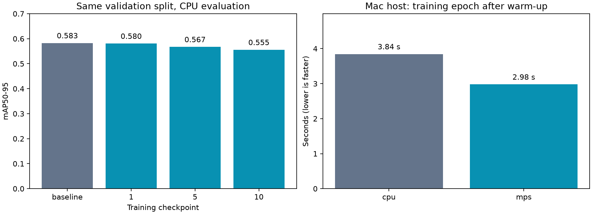

# Chapter 7~9 — 로컬 실습 결과

2026-11-15 KST에 기존 KFP Run을 API로 재확인하고, MovieLens 준비 파이프라인과 CPU/MPS 비교를 추가 실행했다. 아래 수치는 Mac과 로컬 kind `ch5-lab`의 결과다.

## 1. 데이터 준비

COCO128은 train/validation/test 96/16/16장이다. 저장된 manifest와 실제 이미지·라벨의 SHA256이 모두 일치하며 분할 간 이미지 해시 중복은 0이다.

MovieLens는 원본 평점 100,836행에서 seed 42로 6,400행을 선택했다. 준비 Pod가 5,120/640/640행의 Parquet를 만들고 별도 QA Pod가 다시 읽었다. 열 이름, 결측, 평점 범위, 양수 ID·timestamp, 사용자·영화 쌍 중복과 분할 간 중복 검사를 통과했다.

학습에 없는 사용자 또는 영화가 포함된 행은 validation 175행, test 186행이다. 데이터 준비 QA에서는 이 행을 유지한다. 기존 평점 학습 실습은 해당 행을 제외하므로 평가 모집단이 다르다.

- [COCO128 명세 요약](results/data-qa.json)
- [MovieLens QA](results/movielens-data-qa.json)
- MovieLens 준비 Run: `be7bc159-b134-4fcf-b817-f345c0b486ca` (`SUCCEEDED`)

## 2. 객체 탐지 학습·검증

기존 10 epoch 학습에서 저장한 체크포인트를 같은 validation 16장으로 평가한 결과다. 이번 작업에서 10 epoch 학습을 다시 실행하지는 않았다.

| 가중치 | mAP50-95 |
|---|---:|
| 기본 | 0.5825 |
| 1 epoch | 0.5804 |
| 5 epoch | 0.5670 |
| 10 epoch | 0.5554 |

validation 기준으로 기본 가중치가 선택됐고 test mAP50-95는 0.5159였다. 학습 횟수 증가가 성능 향상으로 이어지지 않았다. 작은 표본과 COCO 사전 학습의 영향을 고려해야 하며, 이 결과만으로 성능 하락의 원인을 단정하지 않는다.

CPU/MPS 시간은 각각 3 epoch를 새로 실행했다. 데이터·초기 가중치·batch 8·imgsz 320·SGD 설정을 동일하게 사용했다. 단일 반복 측정이며 클러스터 작업도 동시에 실행 중이었다.

| 장치 | 첫 학습 epoch | 이후 2개 epoch 중앙값 | model.train 전체 시간 |
|---|---:|---:|---:|
| CPU | 3.58초 | 3.84초 | 14.80초 |
| MPS | 4.43초 | 2.98초 | 18.63초 |

학습 epoch 시간은 callback 구간이며 validation 등을 포함한 전체 시간과 다르다. MPS는 반복 학습 구간이 빨랐지만 전체 실행은 CPU가 빨랐다. 측정 중 라이브러리가 변경할 수 있는 CPU 스레드 수를 일정하게 유지했다고 주장하지 않는다.

수치와 원본 결과 경로는 [YOLO 요약](results/yolo-summary.json)에 있다.

## 3. 기존 KFP와 학습 추적 재확인

| Run | 최종 상태 | 확인한 단계 |
|---|---|---|
| Artifact: `a74a32fe-ee00-41ba-a5d0-03ff20afe042` | SUCCEEDED | prepare-data, fit-model, score-model |
| PVC: `71203c12-5e53-464b-84c8-b39731f9f90c` | SUCCEEDED | stage-pvc, train-pvc, inspect-pvc |
| 영화 평점: `31c1dc14-aa99-44c5-ab74-32ebc7c5369d` | SUCCEEDED | train-recommender |

[단계별 상태](results/kfp-runs.json)를 보관했다. PVC를 마운트한 TensorBoard Pod에서 이벤트 파일을 읽어 `train/box_loss`, `train/cls_loss`, `train/dfl_loss`, `time/train_epoch_seconds` 태그를 확인했다. MLflow API에서는 대응 Run `6ff4dc1d20e144bd93b68b99227be45f`의 `FINISHED` 상태와 지표를 확인했다([추적 결과](results/tracking.json)). 이번 검증은 파일·API 기반이며 UI 화면 확인은 포함하지 않는다.

기존 MovieLens 평점 모델의 test RMSE는 0.9433, 평균 평점 기준 모델은 1.0090이다([저장 결과](results/movie-summary.json)). 알려진 사용자·영화의 평점 예측 결과이며 Top-K 추천 품질 검증은 아니다.

## 4. PVC 생명주기와 오류 해결

최종 Run `e717ba18-de00-402f-9637-5ae9dcfef52d`에서 생성 → 쓰기 → 다른 Pod에서 SHA256 대조 → 삭제 요청 네 작업이 모두 `SUCCEEDED`였다. 64Mi PVC가 `Bound`가 된 것을 확인했다.

내장 `kubernetes.CreatePVC`는 PVC 생성 이후 캐시 등록 과정에서 `Invalid task: must specify FingerPrint` 오류가 발생했다. 생성 단계 캐시를 켜도 해결되지 않았다. 실패한 두 Run과 상태는 로컬 `outputs/pvc-lifecycle-first-failure/`, `outputs/pvc-lifecycle-second-failure/`에 보존했다. 최종 코드는 일반 KFP 컴포넌트가 서비스 계정으로 Kubernetes API를 호출하도록 대체했다. 따라서 내장 CreatePVC/DeletePVC 동작 성공 사례로 해석하지 않는다.

삭제 요청 후 PVC는 `Terminating`에 머물렀고 `kubernetes.io/pvc-protection` finalizer와 이 볼륨을 참조하는 완료 Pod 두 개가 남아 있었다. 로그를 저장한 뒤 해당 시험의 완료 Pod 두 개만 삭제하자 PVC와 PV가 모두 사라졌다. 기존 학습용 `chapter9-data` PVC는 유지했다.

- [Bound 상태](results/pvc-bound.json)
- [삭제 지연 당시 참조 관계](results/pvc-deletion.json)
- [추가 실습 최종 상태](results/followup-runs.json)

## 남은 범위

이번 실습은 소형 데이터와 단일 노드 환경의 연결·재현성 검증이다. MovieLens 전체 데이터, 시간 분할, Top-K 추천·모델 승격, 다중 노드 PVC, 통계적으로 충분한 반복 벤치마크는 포함하지 않는다. GPU 비교는 Mac 호스트의 MPS이며 kind Pod에서는 CPU를 사용했다.

## 환경 분리 후 검증

9장 전용 가상환경에서 의존성 검사, PVC·영화 파이프라인 컴파일, 기존 Run 조회를 통과했다. 영화 평점 학습을 새로 1 epoch 실행해 모델·지표·MLflow 기록을 생성했다. 이후 전용 이미지 빌드와 KFP 재제출도 완료했다. 아래 새 실행 기록을 참고한다.

[환경 검증 기록](results/environment-check.json)

## 전용 이미지로 KFP 재실행 — 2026-11-15 KST

각 장의 requirements와 Dockerfile로 이미지를 빌드·등록하고 digest로 고정해 실행했다. 첫 빌드는 패키지 다운로드 중 읽기 시간 초과로 실패했고, pip timeout을 120초로 늘린 재시도에서 성공했다. 실패·성공 빌드 로그는 로컬 `outputs/separate-kfp/`에 보존했다.

| 실습 | 새 Run ID | 결과 |
|---|---|---|
| pvc | `b2d3c897-4ed6-4440-a2f7-dffe09c810b5` | 모든 필수 작업 SUCCEEDED |
| movie | `717d4b87-0e3e-46b3-8288-d531102e723e` | 모든 필수 작업 SUCCEEDED |
| pvc-lifecycle | `23fdf38d-f70e-4df8-be7b-6303f64d4da7` | 모든 필수 작업 SUCCEEDED |

[실행 이미지 digest](results/separate-kfp/image.txt)를 실제 Pod 이미지와 대조했다.

- [pvc 작업·이미지 검증](results/separate-kfp/pvc-verification.json)
- [movie 작업·이미지 검증](results/separate-kfp/movie-verification.json)
- [pvc-lifecycle 작업·이미지 검증](results/separate-kfp/pvc-lifecycle-verification.json)

새 PVC 학습의 TensorBoard 손실 태그와 MLflow `FINISHED` 상태를 확인했다([추적 증거](results/separate-kfp/tracking.json)). 영화 평점 test RMSE는 0.9433, 평균 기준 모델은 1.0090이다([결과](results/separate-kfp/movie-result.json)). 시험용 볼륨을 참조하는 완료 Pod만 정리한 뒤 PVC/PV 삭제를 확인했다([정리 기록](results/separate-kfp/cleanup.json)).
